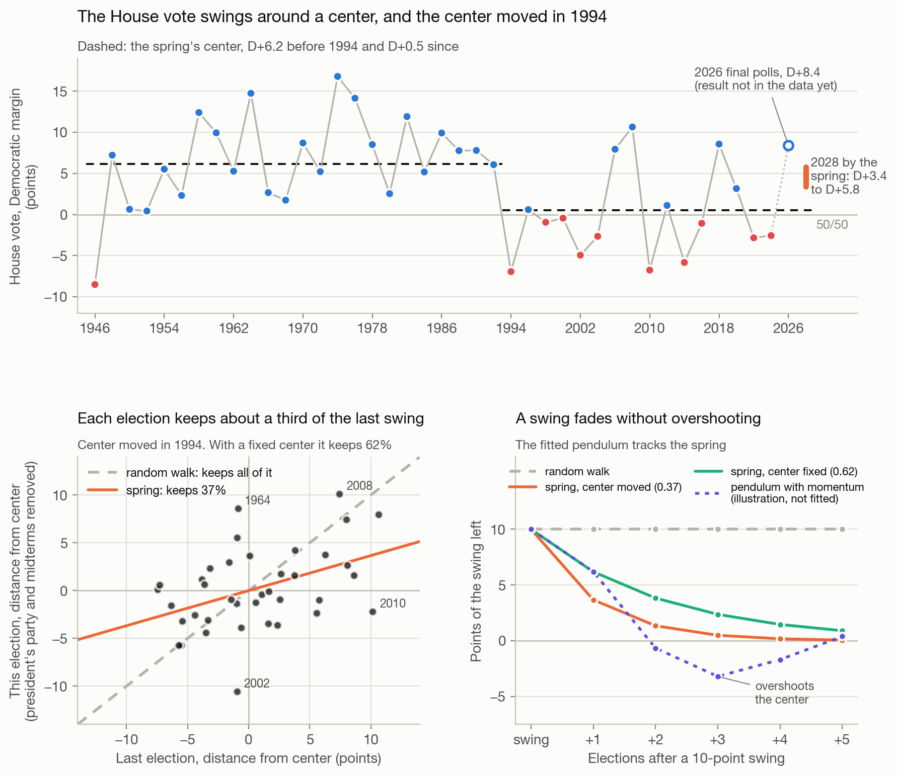

# The pendulum test

Written November 6, 2026. Does the national House vote swing like a pendulum? Code in [`campaign/pendulum_test.py`](campaign/pendulum_test.py), results in [`data/pendulum_results.json`](data/pendulum_results.json).

**The short answer.** The vote is pulled back toward the center, so it isn't Brownian motion. It has no momentum, though: it doesn't carry past the center, so it isn't a pendulum either. It's a spring. Once the president's party and the midterm penalty are in, about 40% of any swing away from the center is gone by the next election. If the center is allowed to move in 1994, about 60% is gone. The spring doesn't improve on the polls, though: blended with them, it scores worse.

*Top: the national House vote, 1946-2024, around the spring's center (the fit with the center moved in 1994). Bottom left: each election's distance from the center against the last one's, with the president's party and midterm penalty taken out. A random walk would sit on the dashed diagonal, and a spring sits on a flatter line through zero. Bottom right: what's left of a 10-point swing over the next five elections. The dotted pendulum is an illustration of the overshoot the test looked for. It wasn't fitted, and the fitted pendulum is close to the spring. Drawn by `campaign/plots/plot_spring.py`.*

## The question

Black-Scholes models a price as Brownian motion, a random walk with nothing pulling it back. Its spread grows forever. A pendulum adds two things: a force back toward the center, and momentum that can carry it past. Sampled every two years, a damped oscillator `x'' + g x' + w^2 x = noise` is an AR(2), so the three pictures can be fit and scored side by side:

| Picture | Model | Physics |
|---|---|---|
| Brownian motion | `y_t = y_{t-1} + c` | No pull back to the center |
| Spring | `y_t = c + p1 y_{t-1}` | Pulled back, no momentum |
| Pendulum | `y_t = c + p1 y_{t-1} + p2 y_{t-2}` | Pulled back, and can overshoot |

`y_t` is the Democratic margin of the national House vote. Momentum shows up as complex roots (`p1^2 + 4 p2 < 0`), which needs `p2 < 0`. The roots then give the swing's period.

The midterm penalty swings the vote back and forth by itself, so each picture is also fit with the known forces: `s_t` (+1 Democratic president, -1 Republican) and `s_t × midterm_t`, as in [REPORT](REPORT.md) §8. A model of the forces alone is the benchmark.

## Data

40 elections, 1946-2024. 1976-2024 is `national_vote.py` (MIT). 1946-1974 is each year's Wikipedia infobox (Clerk of the House totals), saved in `data/raw/wikipedia/house_vote/`. Over 1976-2024 the two agree within 0.2 points in 20 of 25 years (1992 is the worst, 1.1).

## The rules

These were written in `pendulum_test.py` before any model was scored. They weren't committed separately before the run. No 2026 margins are used.

- Every model is scored on the same elections: leaving one out (1950-2024) and forward in time (each year from 1980 predicted from 1950 up to the year before).
- **Momentum**, with the forces in both: the pendulum must (a) beat the spring both ways, (b) have complex roots, and (c) have a `p2` at least as negative as what fewer than 10% of 10,000 simulated springs produce.
- **Pull back**, with the forces in both: the spring must beat Brownian motion both ways, with fewer than 10% of 10,000 simulated random walks giving a `p1` that far below 1.
- **Sensitivity:** the same tests with the center allowed to move after the 1994 realignment.

## Results

Prediction error of the House vote (root mean square, points):

| Model | Leaving one out | Forward, 1980-2024 | Forward, 2012-2024 |
|---|---|---|---|
| Brownian motion | 7.16 | 7.26 | 6.59 |
| Spring | 6.00 | 6.33 | 5.46 |
| Pendulum | 6.08 | 6.42 | 5.58 |
| Brownian motion + forces | 4.78 | 5.47 | 3.38 |
| **Spring + forces** | **4.46** | **5.11** | 2.37 |
| Pendulum + forces | 4.52 | 5.16 | **2.29** |
| Forces only | 5.39 | 5.51 | 3.71 |

**Pull back: passes.** With the forces in, `p1` = 0.62, so 38% of a swing away from the center is gone by the next election, and half within about 3 years. The spring beats Brownian motion both ways, and 1.2% of simulated random walks give a `p1` that far below 1. With the center moved in 1994 the pull is stronger: `p1` = 0.37, 0.1% of simulations. That model puts the center at D+6.2 before 1994 and D+0.5 after, close to 50/50.

**Momentum: fails all three parts.** `p2` = +0.07, the wrong sign for overshoot. The roots are real (0.67 and -0.10), so there's no oscillation. The pendulum loses to the spring both ways (4.52 vs 4.46, 5.16 vs 5.11), and 74% of simulated springs give a `p2` at least as negative. With the center moved, the answer is the same (`p2` = +0.01, 59%).

**The swing you can see is the presidency.** Without the forces and with the center moved, the pendulum does find complex roots: an 8-year period, the length of a two-term presidency. That cycle is small (0.25 of a swing left after one election), and it disappears once the president's party is in the model.

## Readings, not tests

**The random kicks.** This is the spread of the spring's residuals, the Wiener term's size. It was 3.5 points over 1950-1992 and 5.8 in the wave years of 1994-2010, and it has been 2.1 since 2012. These eras were picked after seeing the series.

**Against the polls, 2012-2024.** Knowing only the last House vote and the president's party, the spring missed by 2.37 points forward. The September 1 polls missed by 3.04 and the final polls by 2.04 ([REPORT](REPORT.md) §8). That's seven calm elections, though. Over 1980-2010 the spring missed by far more, because it can't see a wave coming: it was off by 12.6 points in 2002, 10.3 in 1980, 9.7 in 2010 and 6.7 in 1994. This was a lead, and the blend test below rejects it.

**2026, from 2024 and earlier.** The final generic ballot was D+8.4. These predictions use no 2026 data, but they were computed after the election.

| Model | Center fixed | Center moved in 1994 |
|---|---|---|
| Spring + forces | D+5.9 | D+4.5 |
| Pendulum + forces | D+5.7 | D+4.5 |
| Forces only | D+8.5 | D+4.3 |
| Brownian motion, no forces | R+2.8 | R+3.1 |

**2028, if 2026 lands at D+8.4.** In a presidential year with a Republican president there's no midterm penalty, so the spring pulls the vote back without overshooting. With the center fixed, the spring + forces model gives D+5.8. With the center moved, it gives D+3.4. In general, 2028 ≈ 0.6 + 0.62 × the 2026 margin with the center fixed, or 0.3 + 0.37 × the 2026 margin with it moved. This isn't a forecast: it knows nothing about the 2028 candidates.

## The blend: does the spring add to the polls?

**No.** The rules were written in `pendulum_test.py` before the blend was scored. The blend is `y = poll + a + w (spring - poll)`: `w` = 0 is the polls plus their average lean, and `w` = 1 is the spring alone. Each year's spring prediction comes from 1950 up to the year before, so it never sees the year it predicts. It's scored over REPORT.md §8's 12 elections (2002-2024) in the same two ways: leaving one out, and forward from 2012. To pass, the blend had to beat the polls both ways, and fewer than 10% of 20,000 shuffles of the spring across years could give a leave-one-out error as low.

Prediction error of the House vote (root mean square, points):

| Polls | Spring's center | Polls plus lean: one out | Polls plus lean: forward | Blend: one out | Blend: forward | `w` | Shuffles as good | Passes |
|---|---|---|---|---|---|---|---|---|
| **Sept 1** | Fixed | 3.40 | 3.04 | 3.72 | 3.04 | 0.10 | 77% | No |
| Sept 1 | Moved in 1994 | 3.40 | 3.04 | 3.73 | 3.11 | 0.01 | 80% | No |
| Final | Fixed | 2.44 | 2.04 | 2.90 | 2.09 | 0.12 | 85% | No |
| Final | Moved in 1994 | 2.44 | 2.04 | 2.89 | 2.07 | 0.10 | 82% | No |

The polls-plus-lean column matches REPORT.md §8. The blend gives the spring about a tenth of the weight. That's worse than the polls alone leaving one out, and only ties them forward (3.036 against 3.044 for Sept 1). A free regression, `y = a + b poll + c spring`, does worse again (3.92 and 3.39 for Sept 1).

**Why the lead didn't hold.** The spring beat the September polls over 2012-2024 because those were calm years. In 2002-2010 the waves were big, and the polls saw them while the spring couldn't. In 2002 the spring said D+7.6, from the midterm penalty, and the vote came in at R+4.9. The September polls were already at D+2.0. By September the polls already contain everything the spring knows: last election and who holds the White House.

## Limits

- 40 elections is few for telling an AR(1) from an AR(2). The sign of `p2` matters more than its size here, and it points the wrong way for momentum.
- A sampled oscillator is strictly an ARMA(2,1). The AR(2) is the usual approximation.
- The center isn't fixed. The 1994 realignment moved it about 6 points, and the moved-center version shows how much of the spring's memory came from that shift.
- Published Brownian-motion election models (Taleb 2018; Fry and Burke 2020) treat the vote as a random walk. For the national House vote, that's the worst of the three pictures here.
