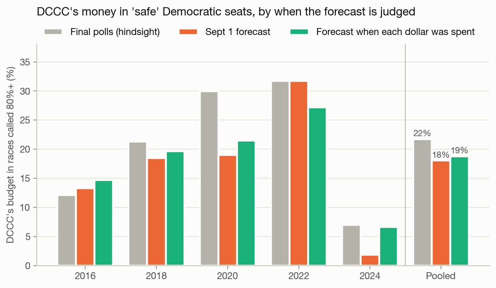
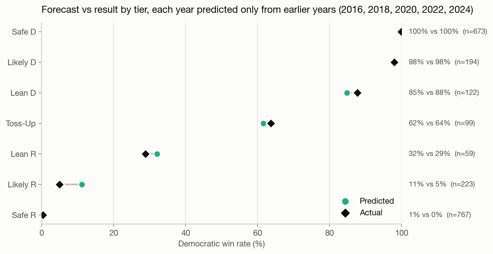
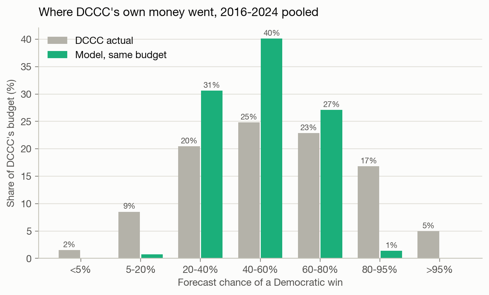
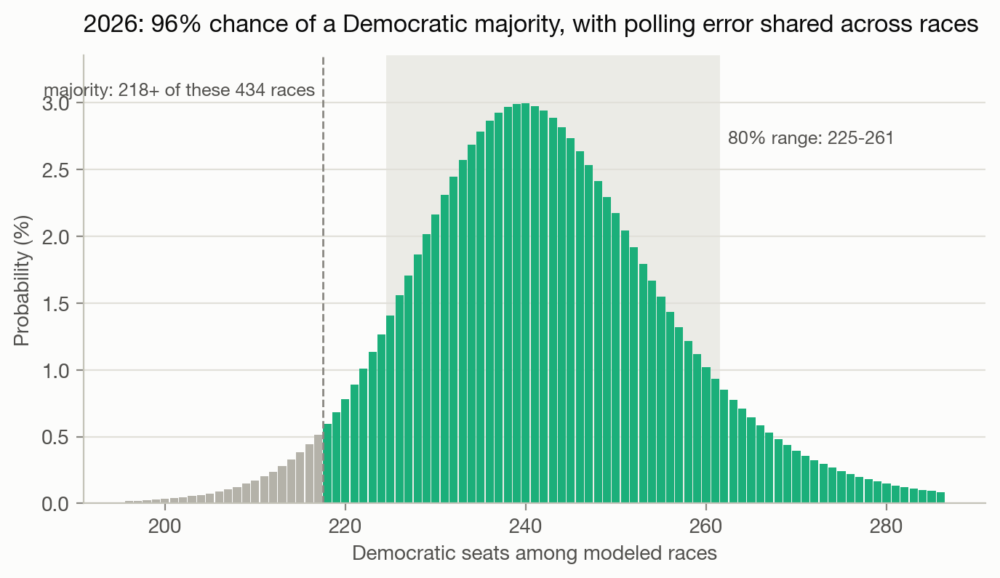

# Campaign Allocation

Where should a party committee spend its money across House races? A calibrated race-by-race forecast, an explicit assumption about what party money does, and a test of DCCC's real spending against the best use of the same budget, with the 2026 forecast published before Election Day.

October-November 2026 · 2016-2024 backtests complete · 2026 forecast frozen Nov 2, scoring pending

`Forecasting` `Constrained Optimization` `Game Theory` `Campaign Finance` `Out-of-Sample Testing`

**Contents**

1. The question
2. Approach
3. What "DCCC's spending" means, and when it's judged
4. What public data can't say about money
5. Results
6. The 2026 test
7. What didn't work
8. How the project changed
9. Methods and data

**Role:** Researcher and developer · **Team:** Solo · **Code:** [github.com/callum-doty/Campaign-Allocation](https://github.com/callum-doty/Campaign-Allocation)

---

## 1. The question

Research on campaign finance usually asks whether spending affects elections. A party committee faces a narrower question: given a fixed budget, which races should get the next dollar? And how close did its actual spending come to that answer?

I split this into two jobs that can each be checked on their own:

1. **Forecast each race** from public data that a September decision could actually see.
2. **State what party money does** as an explicit, adjustable assumption. Then spend the budget where it buys the most expected seats, and compare with what DCCC did.

## 2. Approach

**A forecast that only sees what September could see.** Least squares on 2,626 contested House races, 2012-2024. Features: partisan lean on each election's own district lines, incumbency (with first-term members flagged), challenger experience (a Wikipedia article by Jan 1 of the election year), how the seat's party ran last time, and money. Money counts only what candidates had raised from others by June 30 and what outside groups had spent by Aug 31. Fall money is left out on purpose, because it follows how the race is going. Counting it made close races look easier to call than they were (log loss 0.410 against 0.421 on the 378 races the September forecast put between 5% and 95%).

**Correlated error.** When the polls miss, they miss everywhere at once. Each race's error splits into national (2.8 points), state (3.5) and district (6.1) parts. The national part is estimated from only 7 elections, so the seat total treats its size as uncertain (a Student t with 6 degrees of freedom) rather than known.

**Allocation.** Party money's effect is a curve with diminishing returns in dollars: `shift = 1.5 × log(1 + x / $5.5M)` points. It applies only to deviations from what DCCC actually spent, so the forecast already reflects the money that was spent. With a 15% cap per race, greedy allocation is exact here, because each race's win probability is concave in spending over the relevant range. A numerical solver lands within 0.01 seats of it.

**A strategic opponent.** DCCC against NRCC as a two-player game, each re-spending its real budget, solved by fictitious play.

**Timing.** Persuasion from TV ads fades within days in field experiments, and many voters cast ballots weeks before Election Day (federal EAVS data). Each dollar is counted by how much of its effect is left when that state's voters actually vote.

## 3. What "DCCC's spending" means, and when it's judged

- **Only DCCC's own dollars.** "Observed allocation" means DCCC's independent expenditures in House general elections, not candidate money and not allied super PACs. Amended FEC reports have to be deduplicated, or 2024 reads as $103.0M instead of $74.2M (FEC publishes $74.26M). In 2026 the money is coordinated spending: after *NRSC v. FEC* (June 2026), both committees report $0 of independent spending.
- **Judged before the money lands, three ways.** By the forecast on Sept 1. By the forecast on the date each dollar reached voters, at five checkpoints from Sept 1 to Oct 25. And by the final-poll forecast, for reference only.
- **Emergency spending isn't read as a result.** The forecast's money term leaves out party money and anything spent after Aug 31, so a race DCCC rushed money into isn't rated safer because of that money. Its next dollar is valued on the same curve as every other race's, at what DCCC actually spent there.

## 4. What public data can't say about money

Public data can't separate the effect of money from the reasons it goes where it goes: close races and strong candidates attract it. So instead of claiming a causal estimate, the project assumes an effect, shows results across nine versions of it, and adds two readings that need much less of it:

- **Break-even.** How strong would party money have to be for reallocating DCCC's budget to gain one full seat? DCCC's first $1M in a race would have to move the margin 1.2-2.7 points, against 0.25 assumed (5-11 times the default). A randomized holdout finding less than 1.23 points per first $1M would rule out a one-seat gain in every cycle tested, under all three curve shapes.
- **Implied belief.** DCCC's own split is optimal only if a dollar in seats already 80%+ Democratic works 1.4-3.3 times as hard as one in a 20-80% race, or those seats are worth that much more to it. The assumed strength of money cancels in this ratio.

## 5. Results

Each year from 2016 to 2024 is forecast only from earlier elections.

- **The forecast is calibrated out of sample.** Brier scores run 0.015-0.037, and predicted and actual win rates match by tier (Toss-up 62% against 64%, n = 99; Lean D 85% against 88%, n = 121). The favorite for the majority won in 5 of 5 years, and the September version's 80% seat range held the result in 5 of 5.

- **DCCC was close to the best use of its money.** Reallocating its budget gains +0.05 to +0.19 expected seats per cycle at the default assumption, and under two seats in every year under all nine assumptions.
- **The gap is defense.** 22% of DCCC's money went to seats the forecast already gave Democrats at 80%+, 72% of it protecting its own incumbents. The model puts about 1% there. Some of that caution was earned: in 2020, 7 of those "safe" seats were lost anyway. Judged with what DCCC could see on Sept 1, the share falls to 18%.

- **Neither strategy nor TV prices explain the defense.** At the two-player equilibrium, DCCC puts at most 2% of its money in 80%+ seats, and both committees' real allocations are within about a tenth of a seat of the equilibrium value. DCCC already spends about half as much per race in the costliest TV markets.
- **If persuasion fades in days, when DCCC spends matters more than where.** At a 4-day half-life, DCCC's money landed at 23-43% of its best timing. The comparison keeps every race's dollars and spreads them over that state's best 14 days for its ballots. Re-timing gains +0.4 to +1.4 expected seats per cycle, against +0.05 to +0.19 for moving money between races. It's an upper bound: late airtime costs more, and lasting effects like name recognition are left out.
- **The same TV slot costs different buyers different amounts.** From about 14,000 station political files at the FCC, coordinated party buys paid the candidate's rate (1.00x), a party's independent buys 2.40x, and the main outside groups 2.3-2.5x. After *NRSC v. FEC*, both committees moved almost entirely to coordinated buying.

| Metric | Value |
|---|---|
| Gain from reallocating DCCC's budget (default assumption) | +0.05 to +0.19 seats per cycle |
| Money strength needed for a one-seat gain | 1.2-2.7 pts per first $1M (0.25 assumed) |
| How hard a safe-seat dollar would have to work | 1.4-3.3x a battleground dollar |
| Gain from re-timing the same dollars (4-day half-life, upper bound) | +0.4 to +1.4 seats per cycle |
| Brier score, forward backtests 2016-2024 | 0.015-0.037 |
| 2026 forecast, frozen before Election Day | 242 D seats (80% range 225-260), 96.5% majority |

## 6. The 2026 test

The 2026 forecast was committed on Nov 2 and merged on GitHub at 20:25 UTC on Nov 3, before any polls closed: [`data/forecast_freeze_2026_v2.csv`](https://github.com/callum-doty/Campaign-Allocation/blob/1d68a8982f167da7c20a5bbd6c1bd70bc6a2dac8/data/forecast_freeze_2026_v2.csv). It records every race's probability under four money specifications, the fitted models, and each race's committee money.

- **At a D+8.4 generic ballot:** 242 expected Democratic seats among 434 modeled races, an 80% range of 225-260, and a 96.5% chance of a majority. The four specifications give 239-242 seats and 95-96.5%.
- **Also written before results:** the one spending feature that passed its test (share of spending in April-June) and a weaker redistricting candidate.
- **Written after polls closed but before any result entered the repo,** and labeled that way: a combinatoric search whose design was committed before scoring, and three predictions about seats the committees entered or skipped.
- **Scoring:** *[add once results are certified]*

**What 2026 can test.** Through Oct 14, NRCC had spent $82M to DCCC's $61M, in largely the same seats (their dollars by race correlate at 0.87). 45% of DCCC's money was in seats the forecast gave it at 80%+, and 44% of NRCC's in seats it gave Republicans under 20%. In 2016-2024, seats with committee money ran closer than the forecast said, more than seats without it. So part of this may be the forecast's overconfidence rather than waste. With every race's committee money recorded before the election, 2026 is the first clean test of that.

## 7. What didn't work

Each of these was fixed before scoring and is reported anyway.

- **Open seats aren't measurably riskier.** Letting each race's error size depend on open seats, redrawn lines and lean scored no better than one error size for every race.
- **Incumbency that drifts by cycle** gets margins closer but calls winners worse in 5 of 5 years.
- **Household cost stress** doesn't predict where the national polls miss, 2002-2024. It makes every test worse.
- **28 candidate forecast features** from campaign spending, vendors, donors and redistricting: two pass narrowly, and a placebo says at least one pass in 28 was about 95% likely by luck. Both are kept as 2026 candidates, not findings.
- **A search over 3,961 feature combinations,** designed and committed before scoring: none clear the family-wise bar. A related test, whether seats that look like ones committees enter run behind the forecast, passed (t = -5.4). Before adopting it, I checked why. It was mostly a known misfit in the forecast's money term, and it made forecasts worse, so it wasn't adopted.

## 8. How the project changed

An earlier version (July 2026) estimated the effect of spending from repeat challengers, as a function of each side's share of spending. It reported that DCCC's spending ran opposite to marginal seat gain (ρ = -0.81), that reallocating would gain about 3 seats, and a large option value of holding money back.

I rebuilt it from scratch under stricter rules: only information available by September, five years scored forward in time, DCCC's own dollars only, and the effect of money stated as an assumption with its break-even shown. A share-based curve also turned out to make the first dollar in a quiet long-shot race look about ten times as powerful as one in a toss-up, so the rebuild uses diminishing returns in dollars instead. Under those rules, the misallocation result didn't hold up: DCCC comes within tenths of a seat of the best use of its budget. The timing question survived in a simpler form that can be checked: how fast persuasion fades, against when ballots are cast.

## 9. Methods and data

**Methods:** least squares with forward-in-time backtests; error split into national, state and district parts, with a Student t national term; seat distributions by numerical integration over the shared errors; greedy concave allocation, checked against a numerical solver; break-even and implied-belief inversions; a two-player zero-sum game solved by fictitious play; a persuasion-decay timing model; permutation and sign-flip (max-T) tests; designs committed before scoring; parsing of station political-file PDFs.

**Data, all public:** MIT Election Lab House returns; The Downballot's presidential results by district; FEC bulk data, API and electronic filings (independent and coordinated expenditures, operating expenditures, itemized donors); Wikipedia revision histories; RealClearPolitics generic-ballot averages; the EAC's Election Administration and Voting Survey; Jonathan Cervas's TV-market maps; FCC station political files; FRED.
