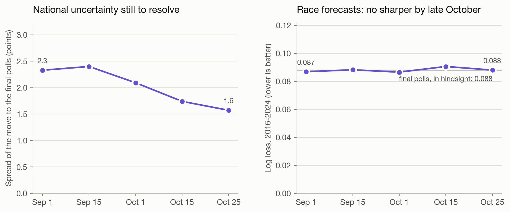
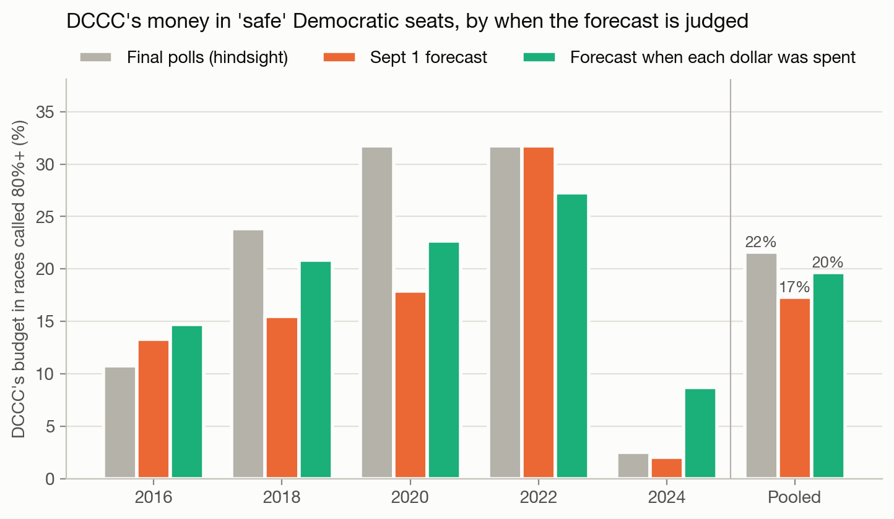
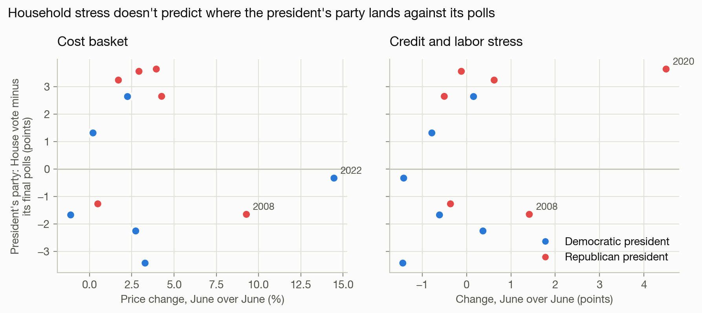
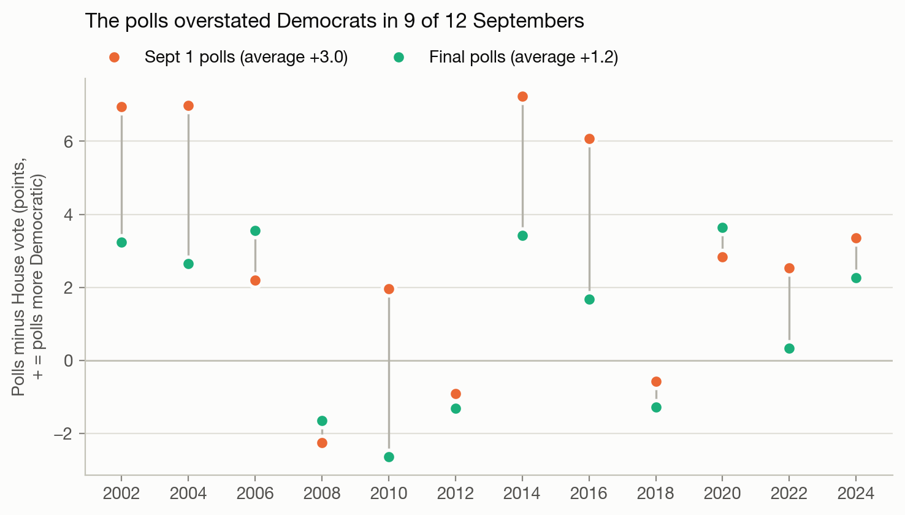

# Campaign allocation report

Generated by `python run.py` on 2026-10-28. Every number below is computed by the pipeline unless marked otherwise.

## Summary

- **The forecast holds up out of sample.** Each year from 2016-2024 was predicted using only earlier elections. Brier scores run from 0.015 to 0.036, and predicted and actual win rates match by tier from Safe D through Lean R (figure 3).
- **DCCC's own spending was close to the best use of the same money, if you trust the polls.** At the default spending assumption, reallocating DCCC's budget would have gained +0.06 to +0.19 expected seats per cycle (average +0.13). Even the most generous assumption tested gains at most +1.75. The main difference: DCCC put 22% of its money into races already 80%+ likely to go Democratic, 73% of it protecting its own incumbents. In 2020 that caution was justified: 7 of those "safe" seats were lost anyway. And part of what looks like over-caution was the forecast's error, not DCCC's. First-term members, many elected in a wave, run well behind the usual incumbency edge. Flagging them, and carrying over each seat's last result, cuts the share of DCCC's 2020 money the forecast calls safe from 37% to 32% (figure 4, sections 4-5).
- **Two readings that don't assume how strong party money is.** Reallocating DCCC's budget gains a full seat only if its first $1M in a race moves the margin 1.2-2.5 points, against 0.25 assumed. And DCCC's own split is optimal only if a dollar in its 80%+ races works 1.5-4.2 times as hard as one in its 20-80% races, or those seats are worth that much more to it (section 5).
- **Judged with what a Sept 1 decision could see, less of that money looks over-cautious.** A forecast built from the Sept 1 polls plus the usual fall drift (about 2 points toward Republicans) is about as accurate on average as the final-poll one (log loss 0.087 against 0.088, better in 1 of 5 years), and its seat ranges hold the result in 5 of 5 years. Under it, DCCC's share in 80%+ seats falls from 22% to 17%. Judging each dollar by the forecast on the date it reached voters instead (checkpoints from Sept 1 to Oct 25), the share is 20%, and what's left still implies a dollar in a safe seat works 1.4-3.0 times as hard. Through the fall the national uncertainty shrinks, but the race forecasts don't get sharper (sections 4-5).
- **Neither strategy nor TV prices explain that defensive spending.** In a two-player game against NRCC, DCCC's best play puts at most 3% of its money in 80%+ seats (figure 5). DCCC already spends about half as much per race in the costliest TV markets, and pricing in market cost makes the model leave them almost entirely. No spender shifts toward mail where TV is most expensive (figure 6).
- **Household stress does not explain where the polls miss.** Over the 12 elections with a final RealClearPolitics generic-ballot average (2002-2024), neither the household cost basket from the HOUSING AFFORDABILITY TRACKER (its own items and weights, pulled from FRED) nor a credit-and-labor stress index predicts where the House vote lands relative to the polls; both make the prediction worse. The same holds against the polls on Sept 1, when the allocation decision is made, and a ballot built from economics alone misses the House vote by more than the September polls do leaving one election out (5.3 points against 3.4) (section 8).
- **2026: the national environment matters more than the new maps.** Redrawn maps in 9 states move Harris-won districts from 72 to 68 in those states (figure 7). At the current D+8.4 generic ballot, the model expects 243 Democratic seats among 434 modeled races (80% range 225-262), a 97% chance of a majority. A 3-point polling miss moves the expected total by about 13 seats (figures 8-9).

## 1. Data

| Source | What | Notes |
|---|---|---|
| [The Downballot](https://www.the-downballot.com/p/the-downballots-calculations-of-presidential) | 2008-2024 presidential results by congressional district, one sheet per set of district lines | Calculations by The Downballot (formerly Daily Kos Elections). Fetched at run time, not redistributed |
| [MIT Election Lab](https://doi.org/10.7910/DVN/IG0UN2) | U.S. House general-election returns, 1976-2024 | CC0. Downloaded by hand (Dataverse asks for a short form) |
| [Jonathan Cervas](https://jonathancervas.com/maps/media-markets/) | Each district's population by Nielsen TV market, 2022-2026 lines | Derived by Cervas from Nielsen market boundaries and Census 2024 county estimates. Parsed from his page at run time, not redistributed |
| [FEC bulk data](https://www.fec.gov/data/browse-data/?tab=bulk-data) | All-candidate summaries (weball), each candidate's principal campaign committee (cn), and every reported independent expenditure, 2012-2026 | Public, no API key |
| [FEC API](https://api.open.fec.gov/developers/) | Each House campaign's July report: money raised and spent through June 30 of the election year, 2012-2026 | Public; needs a free api.data.gov key in `FEC_API_KEY` |
| [`data/generic_ballot.csv`](data/generic_ballot.csv) | Final RealClearPolitics generic-ballot average before each election, 2002-2026, and the average on Sept 1, 2002-2024 | Compiled by hand, sources in the file |
| [FRED](https://fred.stlouisfed.org) | The HOUSING AFFORDABILITY TRACKER's household price basket (41 series) and 4 credit and labor series, monthly or quarterly | Section 8 only. Public, no key. Today's revised values |

**What the raw data gets wrong, and what this repo does about it** (each checked by hand while building this repo, October 2026):

1. **Partisan lean on the wrong map.** A House race has to be compared with the presidential vote *on its own district lines*, which change with every redraw: 2012; FL, NC, PA and VA between 2016 and 2020; 2022; 2024; and 9 states for 2026. Each cycle here uses the sheet for the lines it was run on. PVI uses only the most recent presidential election before the race. In forward tests that gave better-calibrated forecasts (lower Brier scores) than a two-election average in every year from 2016 to 2024.
2. **Court rulings after the data was published.** The Downballot's July 2026 sheet has Missouri on its new map; the U.S. Supreme Court ruled on 2026-09-25 that Missouri votes on its 2022 lines. The 2026 forecast uses the 2022 lines there.
3. **Fusion voting.** In New York and Connecticut one candidate can appear on several party lines. Counting only the Democratic and Republican lines puts NY-01 (2022) at R+6.6; summing each candidate's Working Families and Conservative votes gives the true R+11.0.
4. **State party labels.** Minnesota's Democratic-Farmer-Labor and North Dakota's Democratic-NPL candidates are Democrats. Missing them turns both states into Republican landslides.
5. **Amended reports counted twice.** The FEC's independent-expenditure file keeps every version of a report. An amendment replaces the whole report it amends, so rows from superseded reports are dropped. Raw, the file puts DCCC's 2024 independent spending at $103.0M; with the rule it is $74.2M, against FEC's published $74.26M (2022: $96.4M, matching FEC exactly). House Majority PAC's 2024 total drops from $241M to $196M. Deduplicating by transaction ID instead looks right for DCCC but collapses Congressional Leadership Fund's 2022 spending from $227M to $1M, because its transaction IDs repeat.
6. **Spending with no party attached.** On 10-15% of rows the target candidate's party is blank, including $213M of CLF's $217M in 2024. Dropping those rows undercounts Republican outside money by nearly three quarters in 2024 ($87M instead of $314M). Here the party comes from FEC's candidate list instead: the candidate in that district with that surname. 98-99.5% of every cycle's House general-election spending ends up assigned to a side.
7. **The wrong candidate's money.** FEC's candidate list includes primary losers and House members running for another office, whose committees still sit under their old House district (Gallego, AZ-03, and Schiff, CA-30, in 2024; a stale Sinema committee in AZ-09 spending $4.4M in 2026). Candidates are matched to the names on the November ballot by surname, after stripping accents ("SÁNCHEZ") and searching the whole FEC name for married names ("MATTELIN, CAITLIN RAE DRAPER" is the ballot's Caitlin Draper). Members filed under their pre-redistricting district are matched within the state on surname plus first initial (Schweikert, AZ-01, 2022). For 2026, with no ballot yet, an incumbent flag counts only for a current member from that state who isn't running for Senate this cycle (Hinson in IA-02 and Barr in KY-06 are, so those seats are open). Members leaving for a governor's race or resigning can still be mislabeled, because FEC doesn't track those; IA-04 and SD-00, both safe Republican seats, are the known cases.
8. **Gaps in FEC's summary file.** A few nominees are missing from it altogether (DeLauro in 2016, Cisneros in 2024), and their spending counts as $0. That leaves 1-6 races per cycle decided by under 20 points with an unmatched nominee.
9. **Fraudulent filings.** Some files contain single "expenditures" of $1 billion or more: a "COMMITTEE 300" reports $10B twice "for cash in hand" in 2022, and one person files billions under names like "Warren Buffet" in 2026. No real single House expenditure from 2012 to 2026 tops $5M, so any row over $25M is dropped.
10. **Polls, not results, for the national environment.** A forecast can only use the polling average before the election. (An earlier version of this project used the actual House popular vote for some years, which leaks the answer.)
11. **2026 committee money is invisible here.** *NRSC v. FEC* (June 30, 2026) struck down limits on party coordinated spending. DCCC reports $0 in independent expenditures and $60.9M in coordinated spending for 2026 through Oct 14, and coordinated spending isn't in this file. So the allocation analysis covers 2016-2024, not 2026. Through 2024 coordinated spending was small (DCCC: $5.4M in 2024).

| Cycle | Races | Contested | Generic ballot | DCCC | NRCC | Outside D | Outside R |
|---|---|---|---|---|---|---|---|
| 2012 | 381 | 343 | -0.2 | $50M | $52M | $56M | $84M |
| 2014 | 434 | 356 | -2.4 | $65M | $63M | $44M | $60M |
| 2016 | 406 | 338 | +0.6 | $64M | $64M | $54M | $57M |
| 2018 | 434 | 390 | +7.3 | $73M | $60M | $222M | $188M |
| 2020 | 434 | 404 | +6.8 | $87M | $76M | $212M | $207M |
| 2022 | 433 | 397 | -2.5 | $96M | $86M | $222M | $272M |
| 2024 | 431 | 394 | -0.3 | $69M | $47M | $325M | $300M |
| 2026 | 434 | - | +8.4 | $0M | $0M | $439M | $467M |

Races with under $100K of total spending and Alaska (ranked-choice) are excluded. "Contested" means decided by less than 80 points. Dollar figures are House general-election independent expenditures in modeled races, deduplicated.

## 2. Features

| Feature | Definition | Why |
|---|---|---|
| `pvi` | 100 x (district D two-party presidential share - national share), last presidential election before the race, on the race's own lines | The single strongest predictor |
| `d_incumbent`, `open_seat` | FEC incumbent flag on the matched nominees; a Republican incumbent is the baseline | Incumbents run ahead of their district's lean |
| `floor_share` | log((F_D + $10K) / (F_D + F_R + $20K)), F = what that side's nominee had raised from others by June 30 + outside money that had reached voters by Aug 31 | Candidate strength and how hard each side contests the race, using only money neither national committee controls, and only as much of it as a forecaster deciding on Sept 1 could see |
| `fresh_d`, `fresh_r` | The party's nominee is a first-term incumbent: not among the state's House winners four years earlier | Members first elected in a wave run well behind the usual incumbency edge |
| `over_inc`, `over_open` | Last cycle's margin - that year's generic ballot - 1.6 x its PVI, if the state's lines haven't changed. Set when that party's incumbent runs again (`over_inc`) or the seat is open (`over_open`), zero otherwise | How far the seat's party ran ahead of the district's lean, some of which carries over |
| `gb` | Generic-ballot average before the election | The national environment, applied as a uniform swing |

## 3. The model

The model does two separate jobs.

**Job 1: the baseline forecast** (fit by least squares on contested races, 2012-2024, n = 2622):

```
margin_i - GB = a + b*PVI_i + c*D_incumbent_i + d*Open_i + e*floor_share_i
                + f*fresh_d_i + g*fresh_r_i + h*over_inc_i + k*over_open_i + error_i,   error_i ~ Normal(0, sigma^2)
P(Democrat wins race i) = Phi(expected margin_i / sigma)
```

| a (intercept) | b (PVI) | c (D incumbent) | d (open seat) | e (floor share) | f (first-term D) | g (first-term R) | h (overperformance, incumbent) | k (overperformance, open) | sigma |
|---|---|---|---|---|---|---|---|---|---|
| -1.19 | 1.63 | +8.78 | +4.18 | 2.14 | -3.35 | +0.34 | 0.23 | 0.25 | 7.61 |

Each point of PVI is worth 1.6 points of margin. Having the Democrat rather than the Republican as the incumbent is worth 9 points, 3 less for a first-term Democrat; first-term Republicans show no such gap (+0.3). About a fifth of how far a seat's party ran ahead of its lean last time carries into the next election (0.23 with the incumbent running again, 0.25 for an open seat). The generic ballot is fixed at a 1:1 pass-through rather than estimated: with one national value per cycle, a fitted slope would mostly chase polling misses. sigma is the residual spread, so it includes those misses; that is the right uncertainty for a forecast made before the votes are counted.

**National, state and district error.** Part of every race's error is shared: in a year the polls miss, they miss everywhere at once, and races in the same state also miss together. Splitting it out, sigma^2 = sigma_national^2 + sigma_state^2 + sigma_district^2. sigma_national = 2.8 points is the spread of each cycle's average miss. sigma_state = 3.5 is how much each state's average miss varies beyond what its number of races explains, and sigma_district = 6.2 is the rest. A single race's probability needs only the total. The seat total needs the split: conditional on the national and state misses, races are independent, and averaging over both gives the seat distribution in section 7.

sigma_national rests on only 7 cycle averages, so it is itself uncertain: anywhere from 1.9 to 5.4 points is plausible (90% range). The seat total doesn't treat it as known. Averaging a normal national miss over that uncertainty gives a Student t with 6 degrees of freedom, so a big miss is more likely than the point estimate alone says, and the fewer cycles behind the estimate, the more so. Each race's own probability, and so the allocation, still uses the point estimate.


**Job 2: what party money does.** This is an assumption, not an estimate:

```
shift(x) = scale * log(1 + x / half_saturation),   default scale = 1.5 points, half_saturation = $5.5M
P(Democrat wins i | allocation x) = Phi((expected margin_i + shift(x_i) - shift(observed_i)) / sigma)
```

Public data can't separate the effect of money from the reasons money goes where it goes. Close races and strong candidates attract it. Returns diminish in absolute dollars, not in spending share; a share-based curve makes the first dollar in a quiet long-shot race look ten times as powerful as a dollar in a toss-up. The baseline already reflects the money actually spent, so only deviations from DCCC's observed allocation move a race. Results are shown across a range of both parameters; measured effects (for example randomized holdouts on mail programs) should replace the defaults.


**Allocation.** DCCC's budget is spent greedily: each step funds the race where the next chunk buys the most expected seats, with no race taking more than 15% of the budget. This is exact, not a shortcut. Each race's win probability is concave in its spending unless the race is more than about 40 points out (z < -sigma/scale), so the objective is a sum of concave functions under one budget, and small greedy steps reach the global optimum. A numerical solver lands within 0.01 seats of it. Splitting the error doesn't change this allocation either, because averaging over the national and state misses gives back exactly the pooled sigma.

## 4. Does the baseline forecast well?

Each year is forecast from a model fit only on earlier years.

| Year | Brier score | Expected D seats | Actual D seats | DCCC budget | Gain from reallocating (default) | Gain range (9 assumptions) |
|---|---|---|---|---|---|---|
| 2016 | 0.015 | 189 | 182 | $64M | +0.13 | +0.02 to +1.39 |
| 2018 | 0.036 | 226 | 235 | $73M | +0.19 | +0.02 to +1.75 |
| 2020 | 0.034 | 244 | 222 | $87M | +0.16 | +0.02 to +1.35 |
| 2022 | 0.027 | 207 | 211 | $96M | +0.12 | +0.02 to +1.03 |
| 2024 | 0.016 | 212 | 213 | $69M | +0.06 | +0.01 to +0.82 |

Seats are counted among modeled races, so Alaska and races with under $100K of spending are left out. The biggest miss is 2020, and three errors stacked up there. The polls overstated Democrats nationally, and the average contested race ran 6.4 points behind the forecast. Democratic incumbents ran 9.3 points behind and Republican incumbents only 2.8: the 2020 forecast learned incumbency from earlier years, and the edge shrank sharply after 2016 (section 9). And many of those Democrats were first-term members elected in the 2018 wave. Without the incumbent history below they ran 12.5 points behind the forecast; with it, 8.3, in line with the 9.7 of other Democratic incumbents.

**What the incumbent history adds.** The same forecast without the first-term flags and last cycle's overperformance, fit and scored the same way:

| Year | Brier: without / with | Log loss: without / with | Upsets of an 80%+ favorite: without / with |
|---|---|---|---|
| 2016 | 0.019 / 0.015 | 0.062 / 0.052 | 0 / 1 |
| 2018 | 0.034 / 0.036 | 0.110 / 0.113 | 3 / 5 |
| 2020 | 0.036 / 0.034 | 0.161 / 0.132 | 10 / 8 |
| 2022 | 0.028 / 0.027 | 0.089 / 0.088 | 2 / 2 |
| 2024 | 0.015 / 0.016 | 0.055 / 0.055 | 1 / 0 |

Averaged over 2016-2024, log loss falls from 0.095 to 0.088. The history helps most in 2020 and 2016, and costs a little in 2018.

**What hindsight money was worth.** The money feature counts only what a forecaster deciding on Sept 1 could see: what each nominee had raised by June 30 (the FEC's July report; 67% as much as nominees went on to spend over the whole election), less the candidate's own contributions and loans, and outside money that had reached voters by Aug 31 (3% of all outside money, 2012-2024). An earlier version of this repo counted all of it, though most is spent in the fall and some follows how the race is going. That hindsight version, fit and scored the same way:

| Year | Brier: hindsight / Sept 1 | Log loss: hindsight / Sept 1 | Upsets of an 80%+ favorite: hindsight / Sept 1 |
|---|---|---|---|
| 2016 | 0.015 / 0.015 | 0.051 / 0.052 | 1 / 1 |
| 2018 | 0.035 / 0.036 | 0.110 / 0.113 | 5 / 5 |
| 2020 | 0.034 / 0.034 | 0.135 / 0.132 | 8 / 8 |
| 2022 | 0.026 / 0.027 | 0.084 / 0.088 | 3 / 2 |
| 2024 | 0.015 / 0.016 | 0.054 / 0.055 | 0 / 0 |

Averaged over 2016-2024, log loss is 0.087 with hindsight and 0.088 without. On the 388 races the September forecast put between 5% and 95%, it is 0.407 with hindsight and 0.416 without. So hindsight made the forecast look somewhat better than a September decision could be, mostly in close races. Dropping the money feature altogether forecasts worse than either (tested while building this repo): the money visible by September keeps most of its value.


**The seat total, with the national and state errors shared across races and the size of the national error uncertain:**

| Year | Expected D seats | 80% range | Actual | Needed for majority | P(D majority) | Majority won by |
|---|---|---|---|---|---|---|
| 2016 | 191 | 169-215 | 182 | 207 | 13% | Republicans |
| 2018 | 228 | 209-247 | 235 | 218 | 76% | Democrats |
| 2020 | 244 | 232-257 | 222 (outside) | 218 | 98% | Democrats |
| 2022 | 207 | 190-223 | 211 | 217 | 23% | Republicans |
| 2024 | 212 | 199-225 | 213 | 216 | 36% | Republicans |

The 80% range held the actual result in 4 of 5 years, and the favorite for the majority won in 5 of 5. Outside the range: 2020, when Democrats won 222 against a range of 232-257. ("Needed" counts only modeled races; seats outside the model are credited by their partisan lean.) Each backtest's national error rests only on the cycles before it: 2 for 2016, 6 for 2024. Treating its size as known instead, the 80% ranges average 24 seats wide rather than 34 and hold the result in 4 of 5 years. The fatter tails also pull each race a little toward even, so expected seats here can differ by a seat or two from the race-by-race total in the first table.

**The forecast a Sept 1 decision could make.** Everything above uses the final pre-election generic ballot, which a decision made in September didn't have. The Sept 1 version (`fall_drift.py`) feeds the same fitted model the generic ballot on Sept 1, plus the average fall drift of earlier elections: how far the polls moved between Sept 1 and the final average. It adds the drift's spread to the national error, since every race moves with it. The polls have moved toward Republicans through the fall, by 1.9 points on average over the 11 elections before 2024, give or take 2.3.

| Year | Generic ballot, Sept 1 | Expected fall drift (from earlier elections) | Best guess of the final | Final generic ballot | Log loss: final polls / Sept 1 | 80% seat range: final polls / Sept 1 | Actual seats |
|---|---|---|---|---|---|---|---|
| 2016 | +5.0 | -2.1 (spread 2.5, 7 elections) | +2.9 | +0.6 | 0.052 / 0.063 | 169-215 / 169-229 | 182 |
| 2018 | +8.0 | -2.4 (spread 2.5, 8 elections) | +5.6 | +7.3 | 0.113 / 0.122 | 209-247 / 201-247 | 235 |
| 2020 | +6.0 | -2.2 (spread 2.4, 9 elections) | +3.8 | +6.8 | 0.132 / 0.103 | 232-257 / 219-253 | 222 |
| 2022 | -0.3 | -1.9 (spread 2.5, 10 elections) | -2.2 | -2.5 | 0.088 / 0.089 | 190-223 / 186-227 | 211 |
| 2024 | +0.8 | -1.9 (spread 2.3, 11 elections) | -1.1 | -0.3 | 0.055 / 0.058 | 199-225 / 193-225 | 213 |

Averaged over 2016-2024, log loss is 0.087 at Sept 1 against 0.088 with the final polls. The Sept 1 forecast does better in 2020 and worse in the other 4, as older information should, so its edge on average comes from that one year. Its wider uncertainty makes the seat ranges more honest: they hold the result in 5 of 5 years, against 4 with the final polls.

**Through the fall.** The same forecast can be made at any date (`dated_forecast.py`): the generic ballot that day plus the average drift from that date to the final average, and outside money counted as far as it had reached voters by then, in the training years too. Five checkpoints, with each date's generic ballot and its source in [`data/generic_ballot_dated.csv`](data/generic_ballot_dated.csv):

| Checkpoint | Expected drift to the final average (from the 11 elections before 2024) | Its spread | Log loss, 2016-2024 | DCCC's money that reached voters from then until the next checkpoint |
|---|---|---|---|---|
| Sep 1 | -1.9 | 2.3 | 0.087 | 9% |
| Sep 15 | -0.2 | 2.4 | 0.088 | 25% |
| Oct 1 | -1.2 | 2.1 | 0.087 | 33% |
| Oct 15 | -1.6 | 1.7 | 0.091 | 15% |
| Oct 25 | -1.1 | 1.6 | 0.088 | 19% |
| Final polls (hindsight) | 0 | 0 | 0.088 | |

The national uncertainty shrinks through the fall, from a spread of 2.3 points at Sep 1 to 1.6 by Oct 25. The race forecasts don't get sharper on average, though: log loss stays between 0.087 and 0.091 at every checkpoint, against 0.088 with the final polls. Polls can swing and come back: the checkpoint furthest behind its own year's final-poll forecast is Oct 15, 2016 (log loss 0.073 against 0.052), when the generic ballot stood at +6.2, against a final average of +0.6. (Dollars out before Sept 1 are counted with the Sept 1 checkpoint.)



## 5. Was DCCC's money well placed?

Average gain from reallocating DCCC's budget over 2016-2024, in expected seats per cycle, by spending assumption:

| Scale \ half-saturation | $1.65M | $5.5M | $16.5M |
|---|---|---|---|
| 0.5 pts | +0.13 | +0.04 | +0.02 |
| 1.5 pts | +0.40 | +0.13 | +0.05 |
| 4.5 pts | +1.26 | +0.40 | +0.16 |

Under every assumption tested the answer is "close to optimal": a fraction of a seat at the default, and under two seats even if party money is three times as powerful and saturates three times as fast. The model would put 98% of the money in races between 20% and 80%, against DCCC's 70%.

**How strong would party money have to be?** The grid fixes a strength and asks what reallocating gains. Turned around: how strong would party money have to be for reallocating DCCC's budget to gain one full expected seat? The gain never falls as the scale rises, so each cycle has one break-even scale for each curve shape:

| Year | Scale needed, half-saturation $1.65M / $5.5M / $16.5M | Times the default scale (at $5.5M) | DCCC's first $1M in a race would have to move it |
|---|---|---|---|
| 2016 | 3.4 / 9.1 / 22.9 | 6x | 1.3-1.6 pts |
| 2018 | 2.6 / 7.6 / 20.3 | 5x | 1.2-1.3 pts |
| 2020 | 3.4 / 9.0 / 21.3 | 6x | 1.3-1.6 pts |
| 2022 | 4.4 / 14.6 / 37.0 | 10x | 2.1-2.4 pts |
| 2024 | 5.3 / 15.2 / 38.8 | 10x | 2.3-2.5 pts |

At the default half-saturation the scale would have to be 5 to 10 times the default. Put in dollars, the curve's shape barely matters: under all three half-saturations, a full seat needs DCCC's first $1M in a race to move its margin 1.2 to 2.5 points, against 0.25 assumed. That is a number a measured effect can be checked against. A randomized test that found less than 1.20 points per first $1M would put the gain from reallocating under a seat in every cycle tested, under any of the three curve shapes.


**Where the difference goes: protecting incumbents.** Maximizing expected seats puts almost nothing in races the forecast already has at 80%+; DCCC puts real money there every year:

| Year | DCCC's budget in 80%+ races | Model, same budget | DCCC dollars there | Share to Democratic incumbents | Of those seats, lost anyway |
|---|---|---|---|---|---|
| 2016 | 11% | 0% | $7M | 97% | 0 |
| 2018 | 24% | 0% | $17M | 6% | 0 |
| 2020 | 32% | 2% | $28M | 81% | 7: CA-21, CA-39, CA-48, FL-26, IA-01, IA-02, TX-23 |
| 2022 | 32% | 3% | $30M | 98% | 1: NY-17 |
| 2024 | 3% | 2% | $2M | 93% | 0 |

Outside 2018, most of it protects DCCC's own incumbents, consistent with its "Frontline" program for vulnerable members. In 2018 the 80%+ money went to Republican seats the forecast already had as likely pickups. In 2020 the caution was justified, and part of what looks like over-caution was the forecast's own error. Without the incumbent history, the forecast puts 37% of DCCC's 2020 money in 80%+ seats, and 9 of the seats DCCC defended there were lost, 8 of them held by first-term members. With it, that share is 32%, and NM-02, NY-11, UT-04 drop below 80%. CA-21, CA-39, CA-48, FL-26, IA-01, TX-23 stay above 80% and were lost anyway, and IA-02 is newly rated above 80% and lost. The 2020 forecast still overrated Democratic incumbents as a group (section 4). Whether DCCC's money saved any others can't be seen in this data. So "close to optimal" is conditional on the forecast being right. DCCC's main deviation from it is insurance against it being wrong, concentrated on its own members. Two other objectives were tested while building this repo and are not in the pipeline. Maximizing the probability of a majority reproduces the defense in 2018 and 2020 but goes on offense in years Democrats trail (2016, 2022, 2024). Maximizing expected seats in the worst quarter of national environments adds defense every year, but most in the years DCCC defended least. Neither matches DCCC by itself.

**Judged with what DCCC could see.** DCCC's money reaches voters from September to November: 33% of it by Sept 30 and 33% after Oct 15 (2016-2024). So the readings are redone two ways (section 4): every dollar judged by the Sept 1 forecast, and each dollar judged by the forecast at the last checkpoint before it reached voters ("when spent"). The best allocation and the gain need one forecast for the whole budget, so they use Sept 1.

| Year | DCCC's budget in 80%+ races: final polls / Sept 1 / when spent | Model, same budget, in 80%+ races (Sept 1) | Gain from reallocating: final polls / Sept 1 | 80%+ multiplier: final polls / Sept 1 / when spent |
|---|---|---|---|---|
| 2016 | 11% / 13% / 15% | 0% | +0.13 / +0.13 | 4.2x / 3.3x / 3.0x |
| 2018 | 24% / 15% / 21% | 0% | +0.19 / +0.17 | 2.3x / 2.1x / 2.1x |
| 2020 | 32% / 18% / 23% | 2% | +0.16 / +0.13 | 2.4x / 2.7x / 2.4x |
| 2022 | 32% / 32% / 27% | 3% | +0.12 / +0.11 | 1.7x / 1.7x / 1.7x |
| 2024 | 3% / 2% / 9% | 1% | +0.06 / +0.06 | 1.5x / 1.4x / 1.4x |

Pooled, the share of DCCC's money in races the forecast calls 80%+ falls from 22% to 17%. The change is in 2018 and 2020, years when the final polls ended up more Democratic than a September forecaster, expecting the usual fall drift, would have guessed. Seats that look safe in hindsight looked less safe then. The gain from reallocating barely changes, and DCCC's remaining 80%+ money still implies a dollar there works 1.4-3.3 times as hard as one in a 20-80% race. Judged dollar by dollar, the share is 20%, between the two: later in the fall the polls and the outside money had mostly moved toward what the final-poll forecast says, and the multiplier is 1.4-3.0x. So judging DCCC by what it could see when it spent explains about 9% of its safe-seat spending pooled (20% if every dollar is judged at Sept 1), and not the rest (figure 12).



**What would DCCC have to believe?** The model's allocation stops where the last dollar in every funded race buys the same expected seats (apart from races at the 15% cap). DCCC's own allocation can be read backwards against that condition: at DCCC's actual spending, what does one more expected seat cost at the margin in each band, and how much harder would a dollar have to work in the costlier bands for DCCC's split to be optimal?

| Year | Cost of one more expected seat at the margin (default assumption): under 20% / 20-80% / 80%+ | Multiplier needed: under-20% races | Multiplier needed: 80%+ races | 80%+ multiplier across half-saturations |
|---|---|---|---|---|
| 2016 | $310M / $143M / $603M | 2.2x on $9.6M | 4.2x on $6.9M | 4.1-4.2x |
| 2018 | $260M / $122M / $280M | 2.1x on $13.0M | 2.3x on $17.3M | 2.1-2.6x |
| 2020 | $162M / $120M / $287M | 1.4x on $7.9M | 2.4x on $27.5M | 2.3-2.5x |
| 2022 | none spent / $121M / $204M | no DCCC money | 1.7x on $30.5M | 1.7-1.7x |
| 2024 | $196M / $128M / $188M | 1.5x on $3.9M | 1.5x on $1.7M | 1.0-1.8x |

The multiplier is how many times as far a dollar would have to move the margin in that band, compared with DCCC's 20-80% races, for its split to be optimal. The same number also reads as how many times as much those seats would have to be worth to DCCC, or as a sign that the forecast understates their risk. This data can't tell the three apart. Each band's cost is DCCC's dollars there divided by the expected seats that spending a little more in proportion would buy, a dollar-weighted average of the marginal effect rather than an average of each race's cost, so one small buy in a hopeless race can't dominate a band (a band holding nothing else can). In 80%+ races it runs from 1.5x (2024) to 4.2x (2016). Unlike the gain, it doesn't depend on how strong party money is assumed to be: the strength cancels in the ratio. Moving the half-saturation from $1.65M to $16.5M changes no year's 80%+ multiplier by more than 0.9. The costs in the first column do scale with the assumed strength; only their ratios are free of it.

**Would a committee facing a strategic opponent spend differently?** Another explanation for defending "safe" seats is deterrence: a seat DCCC leaves at $0 is where NRCC's first dollars go furthest. That can be tested by solving the game. DCCC maximizes expected Democratic seats and NRCC minimizes them, each re-spending its real budget under the same spending curve. The payoff is concave for DCCC and convex for NRCC, so a stable equilibrium exists. Fictitious play finds it (each side best-responds to the average of the other's past choices).

| Year | DCCC's budget in 80%+ races: actual | At equilibrium | Expected D seats: actual vs equilibrium | Seats the two sides could still gain: actual | At equilibrium |
|---|---|---|---|---|---|
| 2016 | 11% | 0% | 188.5 vs 188.6 | 0.23 | 0.00 |
| 2018 | 24% | 1% | 226.5 vs 226.5 | 0.36 | 0.00 |
| 2020 | 32% | 2% | 244.2 vs 244.2 | 0.33 | 0.00 |
| 2022 | 32% | 3% | 207.1 vs 207.1 | 0.25 | 0.00 |
| 2024 | 3% | 2% | 211.9 vs 211.9 | 0.11 | 0.00 |

The equilibrium puts almost nothing in 80%+ seats. A raid on a seat that's 85% Democratic buys margin where it barely changes who wins, so it isn't worth deterring. Both committees' actual allocations are within about a tenth of a seat of the equilibrium value. Deterrence doesn't explain the defense either.


Figure 5 shows the whole picture. At equilibrium each side's best reply is to meet the other in the same close races: 97% of DCCC's money and 99% of NRCC's goes to races between 20% and 80%. In reality both spread much wider, DCCC with 30% of its money outside that band and NRCC with 27%. Most of that extra money lands in the same place, seats Democrats are 80%+ likely to win: 22% of DCCC's budget defends them and 22% of NRCC's attacks them. Seats Democrats are under 20% likely to win get far less, 9% of DCCC's budget on offense and 5% of NRCC's on defense.

## 6. TV markets and channels

TV time is bought by market, not by district, so a TV buy pays to reach everyone in the market. [Jonathan Cervas's analysis](https://jonathancervas.com/maps/media-markets/) splits each district's population across Nielsen TV markets for the 2022, 2024 and 2026 lines. His `reach`, the people in a district's main market per district resident, measures how much of a TV buy is wasted. It is 28 for NY-17 (the New York market), against a median of about 5. That overstates the waste where one market holds several battlegrounds: a New York buy reaches NJ-07, NY-04 and NY-17 at once, which cuts the figure to 9.5. So the cost index here counts every battleground district (20-80%) sharing the market. It raises the saturation point only for the TV share of spending, with strength gamma (0 = no market cost, 1 = TV dollars buy proportionally less in costlier markets).

| Year | TV share of DCCC's spending | DCCC per battleground race: costliest quarter of markets vs rest | DCCC's budget in costliest quarter | Model's share there (gamma 0 / 0.5 / 1) | Gain vs DCCC (gamma 0 / 0.5 / 1) |
|---|---|---|---|---|---|
| 2022 | 79% | $0.9M vs $2.0M | 11% | 30% / 7% / 0% | +0.12 / +0.17 / +0.28 |
| 2024 | 74% | $1.9M vs $2.2M | 22% | 26% / 5% / 0% | +0.06 / +0.08 / +0.14 |

DCCC already spends about half as much per race where TV is costliest. Pricing in market cost pushes the model further the same way: with any real cost penalty it leaves those districts almost entirely, and DCCC's gap to the model widens a little. That runs against a common intuition. Expensive districts don't need more money from a seat-maximizer; the same dollar buys less there, so it goes where it buys more.


Mail and digital don't pay for a whole market, so they should take a bigger share where TV is most expensive. Across 2022-2024 they don't:

- **DCCC** shifts only slightly toward digital (19% in the cheapest markets, 24% in the costliest) and reports no mail.
- **House Majority PAC** goes the other way: TV is 76% of its spending in the cheapest markets and 89% in the costliest.
- **All outside groups'** mail share is 7% in the cheapest markets and 7% in the costliest.

Whether that is a missed opportunity depends on how many votes a dollar of mail moves compared with a dollar of TV, which this data can't tell. Randomized holdouts on mail programs can.

## 7. 2026

Forecast from a baseline fit on all 2012-2024 races, at the current generic ballot (D+8.4).


| Generic ballot | D+5.4 | D+8.4 (now) | D+11.4 |
|---|---|---|---|
| Expected Democratic seats | 231 | 243 | 256 |

Averaging over the national and state errors instead of fixing them gives the full distribution. The model puts Democrats at 243 seats among modeled races, an 80% range of 225-262, and a 97% chance of reaching the 218 they need for a majority. That already allows for the size of a national miss being estimated from only 7 elections (section 3); treating it as known would give 98%. It is still likely optimistic: the generic ballot here is the final average, not one a September decision could see, and the state and district errors are still assumed normal. A 4-point polling miss like 2020's would leave Democrats near 227 seats.


53 races sit between 20% and 80%. 14 of them are on redrawn lines; most of the rest are Republican-held seats that a D+8.4 environment puts in play.


**Incumbents on redrawn lines.** The incumbency effect is learned from members running in their own districts, and is probably too large for members whose districts were redrawn. Each redrawn-incumbent race with either chance between 20% and 80% is shown below, with full incumbency credit and with the seat treated as open. The truth likely lies in between, depending on how much of the new district the member already represented.

| Race | Incumbent | PVI | With incumbency | As open seat |
|---|---|---|---|---|
| FL-08 | R incumbent | -7.8 | 15% | 30% |
| FL-12 | R incumbent | -6.8 | 20% | 38% |
| NC-03 | R incumbent | -5.8 | 22% | 41% |
| CA-40 | R incumbent | -6.0 | 24% | 43% |
| FL-13 | R incumbent | -5.8 | 25% | 45% |
| OH-10 | R incumbent | -2.8 | 50% | 71% |
| AL-02 | D incumbent | -6.8 | 51% | 44% |
| FL-09 | D incumbent | -7.8 | 66% | 42% |
| CA-22 | R incumbent | -0.3 | 72% | 87% |
| TX-28 | D incumbent | -4.8 | 82% | 63% |
| OH-09 | D incumbent | -4.8 | 85% | 66% |
| NC-01 | D incumbent | -4.8 | 85% | 67% |
| TX-34 | D incumbent | -4.2 | 85% | 67% |
| FL-14 | D incumbent | -4.8 | 86% | 68% |
| FL-25 | D incumbent | -3.8 | 88% | 71% |

Individual races move 7-24 points, but the shifts run in both directions and largely cancel: treating all 82 redrawn incumbents as open moves the expected Democratic total by +0.6 seats.

## 8. Does household stress explain where the polls miss?

The forecast applies the final generic ballot 1:1 as the national environment. If household costs or credit stress move voters in ways the polls miss, a measure of them should predict where the House vote lands relative to the polls. That is a national question, so it isn't limited to the race-level model's seven cycles: it can use every election with a final RealClearPolitics average, 2002-2024 (12 elections). Earlier years have only single polls from different pollsters, which would mix a much noisier measurement in.

Two composites were fixed before either was compared with an election result (`household_index.py`), both measured June over June of the election year, which a September decision can see:

- **Cost basket:** the household basket from the HOUSING AFFORDABILITY TRACKER sheet, each item's price change weighted 1-3 as the sheet weights it, pulled from FRED. It covers 31 items in 2002 and 41 by 2014, as series start.
- **Credit and labor stress:** the average change, in points, of the unemployment rate, U-6, and banks' credit card and mortgage delinquency rates.

The test (`national_test.py`) regresses the miss (House vote minus generic ballot, Democratic margin) on the polls' average lean, the president's party (+1 Democratic, -1 Republican), and the composite times the president's party. The hypothesis is that the president's party runs further behind its polls when household stress is high. A composite passes only if it beats the model without it both leaving one election out and forward in time (each year from 2012 predicted from the years before), and shuffling it across elections gives an effect at least as strong less than 10% of the time.

The same test also runs against the generic ballot on Sept 1, the polls a September decision actually sees: RealClearPolitics' own average that day, read from the daily series on its pages (2008-2024). For 2002-2006, which have no average for that date, it uses the mean spread of each nonpartisan pollster's latest poll in the 30 days before. Where both exist, that rule lands within about a point of RealClearPolitics' own average. Every value and its source is in [`data/generic_ballot_dated.csv`](data/generic_ballot_dated.csv).

| Year | President's party | Generic ballot, Sept 1 | Generic ballot, final | House vote | Miss vs Sept 1 | Miss vs final | Cost basket | Credit and labor stress (pts) |
|---|---|---|---|---|---|---|---|---|
| 2002 | Republicans | +2.0 | -1.7 | -4.9 | -6.9 | -3.2 | +1.7% | +0.62 |
| 2004 | Republicans | +4.3 | +0.0 | -2.6 | -7.0 | -2.6 | +4.3% | -0.50 |
| 2006 | Republicans | +10.1 | +11.5 | +7.9 | -2.2 | -3.6 | +2.9% | -0.12 |
| 2008 | Republicans | +8.4 | +9.0 | +10.7 | +2.3 | +1.7 | +9.3% | +1.42 |
| 2010 | Democrats | -4.8 | -9.4 | -6.8 | -2.0 | +2.6 | +2.2% | +0.16 |
| 2012 | Democrats | +0.2 | -0.2 | +1.1 | +0.9 | +1.3 | +0.2% | -0.78 |
| 2014 | Democrats | +1.4 | -2.4 | -5.8 | -7.2 | -3.4 | +3.3% | -1.44 |
| 2016 | Democrats | +5.0 | +0.6 | -1.1 | -6.1 | -1.7 | -1.1% | -0.61 |
| 2018 | Republicans | +8.0 | +7.3 | +8.6 | +0.6 | +1.3 | +0.5% | -0.36 |
| 2020 | Republicans | +6.0 | +6.8 | +3.2 | -2.8 | -3.6 | +4.0% | +4.50 |
| 2022 | Democrats | -0.3 | -2.5 | -2.8 | -2.5 | -0.3 | +14.5% | -1.42 |
| 2024 | Democrats | +0.8 | -0.3 | -2.6 | -3.4 | -2.3 | +2.7% | +0.37 |

Prediction error of the miss (root mean square, points):

| Model | Final polls: leaving one out | Final polls: forward, 2012-2024 | Sept 1 polls: leaving one out | Sept 1 polls: forward |
|---|---|---|---|---|
| Polls' average lean | 2.44 | 2.04 | 3.40 | 3.04 |
| + president's party | 2.61 | 2.78 | 3.72 | 3.42 |
| + president's party in midterms (no economic data) | 2.89 | 3.24 | 4.12 | 3.93 |
| + cost basket x president's party | 2.97 | 3.65 | 4.41 | 5.12 |
| + credit and labor stress x president's party | 2.74 | 3.49 | 3.91 | 4.65 |

Neither composite earns a place in the forecast. The basket's effect points the way the hypothesis says but is small: -0.07 points per point of basket inflation, about -1.0 in 2022, and shuffling the basket across elections gives one at least as negative 36% of the time. Credit and labor stress runs the opposite way (+0.39 per point; 76% of shuffles come out at least as negative). The two biggest shocks show why. In 2022 the basket rose 14.5%, the most of any year here, and Democrats, the president's party, ran 0.3 points behind their final polls. In 2020 credit and labor stress rose the most (+4.5 points), and Republicans, the president's party, ran 3.6 points ahead of their final polls. Knowing which party holds the White House doesn't help either: the polls' average lean alone (Democrats running 1.2 points behind their final polls) predicts best.



**Against the September polls the answer is the same.** Neither composite earns a place there either: the basket's effect is -0.08 per point (39% of shuffles at least as negative) and stress's -0.08 (46%). The September polls miss by more than the final ones, 3.4 points against 2.4 leaving one out, and they lean: Democrats ran behind their Sept 1 polls in 9 of 12 years, by 3.0 points on average. Most of that is gone by the final polls (1.2 points), so the polls tend to drift toward Republicans through the fall. Knowing which party holds the White House or whether it's a midterm doesn't predict how far, and neither do the composites (figure 14).



**Can a ballot built from economics replace the polls?** Predicting the House vote itself (root mean square error, points):

| Prediction | Leaving one election out | Forward, 2012-2024 |
|---|---|---|
| Final polls, plus their average lean | 2.44 | 2.04 |
| Sept 1 polls, plus their average lean | 3.40 | 3.04 |
| Economics only: president's party and a midterm penalty, no economic data | 5.31 | 2.97 |
| Economics only: + cost basket | 6.69 | 8.46 |
| Economics only: + credit and labor stress | 5.69 | 4.50 |

Leaving one election out, the best economics-only ballot misses by 5.3 points, against 3.4 for the September polls and 2.4 for the final ones. Forward in time, the version with no economic data at all, only which party holds the White House and whether it's a midterm, roughly ties the September polls (2.97 against 3.04). Adding the cost basket or credit and labor stress makes it worse (8.46 and 4.50).

The final polls already move a little with both: the president's party's generic-ballot margin correlates -0.17 with the basket and -0.32 with stress across these years, so by November some of it is priced in.

The same 12 elections give a second reading on the size of a national miss: a standard deviation of 2.3 points, against sigma_national = 2.8 from the race-level model's 7 cycles. They measure slightly different things (the national vote against the poll, and the average miss in modeled races), but both put a typical national miss at two to three points.

What this doesn't settle: whether the same stress moves some districts more than others (district exposure from Census data times these composites), and whether the values as first published, rather than today's revised ones, would do better.

## 9. Limitations

- **The spending effect is assumed.** The allocation results depend on it, and public data can't pin it down. Section 5 adds two readings that need less of it: how strong it would have to be for reallocating to matter, and what DCCC's own allocation implies. Both still assume the same curve in every race, and that each party's money moves the margin independently of the other's.
- **Likely R seats are overrated**, at about 12% predicted against 5% actual. Most of the gap is 2020 (26% predicted, 0% actual), the national polling miss again, rather than a problem in deep-red seats specifically.
- **The incumbency effect has shrunk.** Fit on 2012-2016 alone, having the Democrat rather than the Republican as the incumbent is worth 16 points; on 2018-2024, 5. The model pools every cycle and gives 2026 incumbents 9 points, more than recent cycles alone would. Weighting recent cycles more was tested while building this repo and forecast worse forward in time: the fits got noisy and overconfident. The first-term flag captures the part of the decline that can be predicted.
- **The incumbency effect is learned from incumbents running in their own districts**, so it is probably too large for members on redrawn 2026 maps (bounds in section 7).
- **2026 nominees are the top spenders reported so far** until official results name them, and their money counts through June 30, as in past cycles. Where the top spender had no House report through June 30 (a Senate run, a campaign that ended, a primary loser), the actual nominees were looked up by hand, with sources, in [`data/nominees_2026.csv`](data/nominees_2026.csv): 13 districts, AR-04, CA-45, FL-06, GA-09, IL-07, ME-02, NC-04, NY-17, TX-07, TX-08, TX-30, VA-11, WI-07. Other districts' top spenders were not checked one by one.
- **The main forecast uses the final pre-election generic ballot.** Section 4 adds the forecast a Sept 1 decision could make, and section 5 redoes the safe-seat readings with it. DCCC spends from September to November, so neither is exactly what it saw for any one dollar. The 2026 forecast uses the latest average.
- **TV-market data starts with the 2022 maps**, so market costs cover the 2022 and 2024 backtests only. Channels come from filers' own purpose descriptions; some say only "MEDIA" and stay unspecified.
- **The national error is estimated from 7 elections.** The seat totals allow for that (a Student t rather than a normal), but each race's own probability, and so the allocation and the backtest scores, still treats its size as known.
