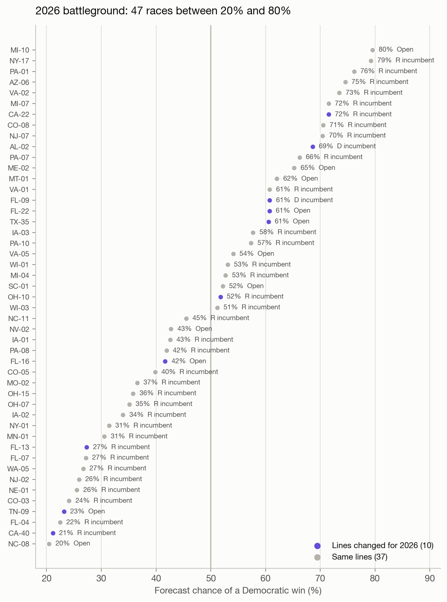

# Campaign allocation report

Generated by `python run.py` on 2026-10-26. Every number below is computed by the pipeline unless marked otherwise.

## Summary

- **The forecast holds up out of sample.** Each year from 2016-2024 was predicted using only earlier elections. Brier scores run from 0.015 to 0.037, and predicted and actual win rates match by tier from Safe D through Lean R (figure 3).
- **DCCC's own spending was close to the best use of the same money.** At the default spending assumption, reallocating DCCC's budget would have gained +0.07 to +0.21 expected seats per cycle (average +0.14). Even the most generous assumption tested gains at most +1.76. The visible difference: DCCC put 23% of its money into races already 80%+ likely to go Democratic (figure 4).
- **2026: the national environment matters more than the new maps.** Redrawn maps in 9 states move Harris-won districts from 72 to 68 in those states (figure 5). At the current D+8.4 generic ballot, the model expects 241 Democratic seats among 434 modeled races, and a 3-point polling miss moves that by about 12 (figure 6).

## 1. Data

| Source | What | Notes |
|---|---|---|
| [The Downballot](https://www.the-downballot.com/p/the-downballots-calculations-of-presidential) | 2008-2024 presidential results by congressional district, one sheet per set of district lines | Calculations by The Downballot (formerly Daily Kos Elections). Fetched at run time, not redistributed |
| [MIT Election Lab](https://doi.org/10.7910/DVN/IG0UN2) | U.S. House general-election returns, 1976-2024 | CC0. Downloaded by hand (Dataverse asks for a short form) |
| [FEC bulk data](https://www.fec.gov/data/browse-data/?tab=bulk-data) | All-candidate summaries (weball) and every reported independent expenditure, 2012-2026 | Public, no API key |
| [`data/generic_ballot.csv`](data/generic_ballot.csv) | Final RealClearPolitics generic-ballot average before each election | Compiled by hand, sources in the file |

**What the raw data gets wrong, and what this repo does about it** (each checked by hand while building this repo, October 2026):

1. **Partisan lean on the wrong map.** A House race has to be compared with the presidential vote *on its own district lines*, which change with every redraw: 2012; FL, NC, PA and VA between 2016 and 2020; 2022; 2024; and 9 states for 2026. Each cycle here uses the sheet for the lines it was run on. PVI uses only the most recent presidential election before the race. In forward tests that gave better-calibrated forecasts (lower Brier scores) than a two-election average in every year from 2016 to 2024.
2. **Court rulings after the data was published.** The Downballot's July 2026 sheet has Missouri on its new map; the U.S. Supreme Court ruled on 2026-09-25 that Missouri votes on its 2022 lines. The 2026 forecast uses the 2022 lines there.
3. **Fusion voting.** In New York and Connecticut one candidate can appear on several party lines. Counting only the Democratic and Republican lines puts NY-01 (2022) at R+6.6; summing each candidate's Working Families and Conservative votes gives the true R+11.0.
4. **State party labels.** Minnesota's Democratic-Farmer-Labor and North Dakota's Democratic-NPL candidates are Democrats. Missing them turns both states into Republican landslides.
5. **Amended reports counted twice.** The FEC's independent-expenditure file keeps every version of a report. An amendment replaces the whole report it amends, so rows from superseded reports are dropped. Raw, the file puts DCCC's 2024 independent spending at $103.0M; with the rule it is $74.2M, against FEC's published $74.26M (2022: $96.4M, matching FEC exactly). House Majority PAC's 2024 total drops from $241M to $196M. Deduplicating by transaction ID instead looks right for DCCC but collapses Congressional Leadership Fund's 2022 spending from $227M to $1M, because its transaction IDs repeat.
6. **Spending with no party attached.** On 10-15% of rows the target candidate's party is blank, including $213M of CLF's $217M in 2024. Dropping those rows undercounts Republican outside money by nearly three quarters in 2024 ($87M instead of $314M). Here the party comes from FEC's candidate list instead: the candidate in that district with that surname. 98-99.5% of every cycle's House general-election spending ends up assigned to a side.
7. **The wrong candidate's money.** FEC's candidate list includes primary losers and House members running for another office, whose committees still sit under their old House district (Gallego, AZ-03, and Schiff, CA-30, in 2024; a stale Sinema committee in AZ-09 spending $4.4M in 2026). Candidates are matched to the names on the November ballot by surname, after stripping accents ("SÁNCHEZ") and searching the whole FEC name for married names ("MATTELIN, CAITLIN RAE DRAPER" is the ballot's Caitlin Draper). Members filed under their pre-redistricting district are matched within the state on surname plus first initial (Schweikert, AZ-01, 2022). For 2026, with no ballot yet, an incumbent flag counts only for a current member from that state.
8. **Gaps in FEC's summary file.** A few nominees are missing from it altogether (DeLauro in 2016, Cisneros in 2024), and their spending counts as $0. That leaves 1-6 races per cycle decided by under 20 points with an unmatched nominee.
9. **Fraudulent filings.** Some files contain single "expenditures" of $1 billion or more: a "COMMITTEE 300" reports $10B twice "for cash in hand" in 2022, and one person files billions under names like "Warren Buffet" in 2026. No real single House expenditure from 2012 to 2026 tops $5M, so any row over $25M is dropped.
10. **Polls, not results, for the national environment.** A forecast can only use the polling average before the election. (An earlier version of this project used the actual House popular vote for some years, which leaks the answer.)
11. **2026 committee money is invisible here.** *NRSC v. FEC* (June 30, 2026) struck down limits on party coordinated spending. DCCC reports $0 in independent expenditures and $60.9M in coordinated spending for 2026 through Oct 14, and coordinated spending isn't in this file. So the allocation analysis covers 2016-2024, not 2026. Through 2024 coordinated spending was small (DCCC: $5.4M in 2024).

| Cycle | Races | Contested | Generic ballot | DCCC | NRCC | Outside D | Outside R |
|---|---|---|---|---|---|---|---|
| 2012 | 381 | 343 | -0.2 | $50M | $52M | $56M | $84M |
| 2014 | 434 | 356 | -2.4 | $65M | $63M | $44M | $60M |
| 2016 | 406 | 338 | +0.6 | $64M | $64M | $54M | $57M |
| 2018 | 434 | 390 | +7.3 | $73M | $60M | $222M | $188M |
| 2020 | 434 | 404 | +6.8 | $87M | $76M | $212M | $207M |
| 2022 | 432 | 396 | -2.5 | $96M | $86M | $222M | $272M |
| 2024 | 431 | 394 | -0.3 | $69M | $47M | $325M | $300M |
| 2026 | 434 | - | +8.4 | $0M | $0M | $439M | $467M |

Races with under $100K of total spending and Alaska (ranked-choice) are excluded. "Contested" means decided by less than 80 points. Dollar figures are House general-election independent expenditures in modeled races, deduplicated.

## 2. Features

| Feature | Definition | Why |
|---|---|---|
| `pvi` | 100 x (district D two-party presidential share - national share), last presidential election before the race, on the race's own lines | The single strongest predictor |
| `d_incumbent`, `open_seat` | FEC incumbent flag on the matched nominees; a Republican incumbent is the baseline | Incumbents run ahead of their district's lean |
| `floor_share` | log((F_D + $10K) / (F_D + F_R + $20K)), F = candidate + outside spending that side | Candidate strength and how hard each side contests the race, using only money neither national committee controls |
| `gb` | Generic-ballot average before the election | The national environment, applied as a uniform swing |

## 3. The model

The model does two separate jobs.

**Job 1: the baseline forecast** (fit by least squares on contested races, 2012-2024, n = 2621):

```
margin_i - GB = a + b*PVI_i + c*D_incumbent_i + d*Open_i + e*floor_share_i + error_i,   error_i ~ Normal(0, sigma^2)
P(Democrat wins race i) = Phi(expected margin_i / sigma)
```

| a (intercept) | b (PVI) | c (D incumbent) | d (open seat) | e (floor share) | sigma |
|---|---|---|---|---|---|
| -2.10 | 1.64 | +10.46 | +5.51 | 2.57 | 7.82 |

Each point of PVI is worth 1.6 points of margin. Having the Democrat rather than the Republican as the incumbent is worth 10 points. The generic ballot is fixed at a 1:1 pass-through rather than estimated: with one national value per cycle, a fitted slope would mostly chase polling misses. sigma is the residual spread, so it includes those misses; that is the right uncertainty for a forecast made before the votes are counted.


**Job 2: what party money does.** This is an assumption, not an estimate:

```
shift(x) = scale * log(1 + x / half_saturation),   default scale = 1.5 points, half_saturation = $5.5M
P(Democrat wins i | allocation x) = Phi((expected margin_i + shift(x_i) - shift(observed_i)) / sigma)
```

Public data can't separate the effect of money from the reasons money goes where it goes. Close races and strong candidates attract it. Returns diminish in absolute dollars, not in spending share; a share-based curve makes the first dollar in a quiet long-shot race look ten times as powerful as a dollar in a toss-up. The baseline already reflects the money actually spent, so only deviations from DCCC's observed allocation move a race. Results are shown across a range of both parameters; measured effects (for example randomized holdouts on mail programs) should replace the defaults.


**Allocation.** DCCC's budget is spent greedily: each step funds the race where the next chunk buys the most expected seats, with no race taking more than 15% of the budget.

## 4. Does the baseline forecast well?

Each year is forecast from a model fit only on earlier years.

| Year | Brier score | Expected D seats | Actual D seats | DCCC budget | Gain from reallocating (default) | Gain range (9 assumptions) |
|---|---|---|---|---|---|---|
| 2016 | 0.019 | 190 | 182 | $64M | +0.12 | +0.01 to +1.32 |
| 2018 | 0.034 | 234 | 235 | $73M | +0.20 | +0.02 to +1.76 |
| 2020 | 0.037 | 246 | 222 | $87M | +0.21 | +0.03 to +1.58 |
| 2022 | 0.026 | 205 | 210 | $96M | +0.10 | +0.01 to +0.95 |
| 2024 | 0.015 | 211 | 213 | $69M | +0.07 | +0.01 to +0.90 |

Seats are counted among modeled races, so Alaska and races with under $100K of spending are left out. The biggest miss is 2020, when polls overstated Democrats by about 4 points nationally; a polling miss shifts every race at once.


## 5. Was DCCC's money well placed?

Average gain from reallocating DCCC's budget over 2016-2024, in expected seats per cycle, by spending assumption:

| Scale \ half-saturation | $1.65M | $5.5M | $16.5M |
|---|---|---|---|
| 0.5 pts | +0.14 | +0.05 | +0.02 |
| 1.5 pts | +0.41 | +0.14 | +0.06 |
| 4.5 pts | +1.30 | +0.42 | +0.17 |

Under every assumption tested the answer is "close to optimal": a fraction of a seat at the default, and under two seats even if party money is three times as powerful and saturates three times as fast. The model would put 96% of the money in races between 20% and 80%, against DCCC's 66%. DCCC's extra went mostly to protecting seats the forecast already had at 80% or better; DCCC may be buying insurance against the forecast being wrong, or acting on information this model lacks.


## 6. 2026

Forecast from a baseline fit on all 2012-2024 races, at the current generic ballot (D+8.4).


| Generic ballot | D+5.4 | D+8.4 (now) | D+11.4 |
|---|---|---|---|
| Expected Democratic seats | 229 | 241 | 253 |

47 races sit between 20% and 80%. 10 of them are on redrawn lines; most of the rest are Republican-held seats that a D+8.4 environment puts in play.



## 7. Limitations

- **The spending effect is assumed.** The allocation results depend on it, and public data can't pin it down.
- **Likely R seats are overrated**, at about 13% predicted against 5% actual. Much of that comes from wave years like 2018, when these seats did flip.
- **The incumbency effect is learned from incumbents running in their own districts**, so it is probably too large for members on heavily redrawn 2026 maps.
- **2026 spending is as reported to the FEC so far.** The nominee for each party is the top current spender until official results name them.
- **Uncertainty is treated as independent across races**, which is right for each race's probability but understates how much the seat total can swing in a polling miss (figure 6 shows that directly).
