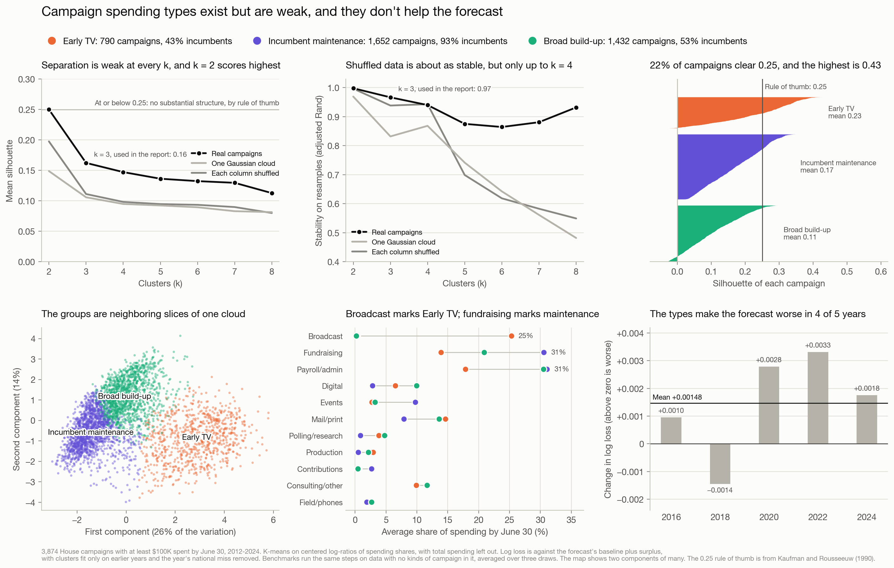

# What House campaigns buy, and whether it predicts anything

Generated by `python -m campaign.spending_report`. Every number is computed from the data unless marked otherwise. Covers the nominees' campaigns in 2012-2024: 3,701,314 payments, $7.6B, from FEC operating expenditures (Schedule B). 2026's results aren't in, so it appears only where a section says so.

## Summary

- **Spending categories don't improve the forecast beyond the June 30 surplus.** The direct test, adding fundraising, voter-contact and overhead money to a forecast that already knows raised minus spent, makes log loss slightly worse (+0.00020, better in 1 of 5 years). The surplus itself remains the gain (-0.00117 against the baseline, better in 4 of 5).
- **The signals people expect mostly fail out of sample.** Discounting receipts by fundraising costs fits well but calls winners worse. Early incumbent polling does signal trouble in the fit, but doesn't help forecasts. Spending more on fundraising goes with doing better, not worse.
- **Candidates do leave TV where it's expensive.** In competitive races in 2022 and 2024, TV falls from 53% of fall budgets in the cheapest markets to 39% in the costliest, while digital rises from 11% to 18%. Independent spenders' TV share moves +6 points on the same comparison, and DCCC's -5 (section 4).
- **The same TV slot costs outside groups at least twice what it costs a candidate, and parties now buy at the candidate's price.** Late in the cycle, in stations' FCC files, coordinated party buys match candidates' rates (1.00x in 2026), a party's independent buys cost 2.40x in 2024, and outside groups pay 2.5x and 2.3x at a typical station in 2024 and 2026. DCCC and NRCC all but stopped buying independently in 2026. That could stretch a party's media dollar about 2.4x. Reallocating would gain about twice as much, but still under a seat, even with a 4x price gap (section 7).
- **The one durable cross-category pattern is polling, then TV.** With size and race type held fixed, a campaign that puts at least 10% of one quarter's budget in polling is about 1.19-1.24 times as likely to put at least 10% of the next quarter's in TV, in later elections as well as the ones the rule was found in.
- **Campaign types are weak and don't help the forecast.** Spending profiles have some real structure, but the clearest split is one column: whether a campaign was on TV by June.
- **A second round of 11 ideas found 0 that clear the bar.** Cash runway, burn rate, debt, channel combinations, purchase order and vendor loyalty all fall short.
- **Donor data doesn't clear the bar either.** 0 of 5 features built from 7.0 million itemized gifts pass. Donor counts fit strongly, but say little the money doesn't (section 2).
- **Incumbents run better where they kept more of their old voters, but it barely helps a forecast.** Across 666 incumbents in five redraws, one who kept half their district ran about 1.3 points behind one who kept all of it, and about 3.2 in races the forecast rated close. The redraws disagree with each other, and the forecast gain is too small to separate from chance (section 6).
- **Treating the generic ballot as a brand survey doesn't improve the forecast.** Shrinking it helps presidential years only through 2020 (-0.0041 on raw log loss, -0.0002 without 2020). The district's lean does count for more in low-money races, but the error isn't tighter there and forecasts don't improve (section 6).
- **The committees move together, but not visibly in reaction to each other.** The other side's spending next week predicts this week's better than last week's does (+0.08 against +0.03), which fits shared plans or news better than a response (section 6).

## 1. The data and its traps

| Trap | What happens | What this does |
|---|---|---|
| Memo rows | A memo row restates part of the payment above it. Counted too, campaigns' totals run 10-18% over what they reported | A payment with memo rows is replaced by them, so a credit card bill's detail is kept and its total counted once |
| Vague purposes | "MEDIA" or "CONSULTING" says little about what was bought | Rules on the text, then each vendor's clearly labeled record, using only payments made so far |
| Hindsight | Fall spending reflects how the race is going | Forecast features use only payments dated through June 30, which the July report disclosed |
| Spending shares sum to 1 | Distances between raw shares mislead, and total spending swamps them | Clusters use centered log-ratios and leave total spending out |
| "Bought X" | Nearly everyone buys a little of everything | Items require 10% of a phase's budget, and rules are compared within budget tercile and race type |

**How well the categories work.** 2,751,033 payments through June 30 carry 133,516 distinct purposes. Claude labeled samples of payments from their purpose and vendor without seeing the classifier's answer. On a first sample, before any tuning, it got 89% right (a count from that check, not recomputed here). After fixing what that showed, a fresh sample gave 89% of a dollar-weighted sample (n = 70) and 84% of a row-weighted one (n = 70), each within about 8 points. So about 11%-16% of payments are misfiled. Claude also wrote the rules, so a person checking `data/purpose_gold.csv` would be a stronger test. 9% of dollars stay vague.

| Category | Whole cycle | Through June 30 |
|---|---|---|
| Broadcast | 29% | 8% |
| Payroll/admin | 17% | 24% |
| Fundraising | 12% | 20% |
| Mail/print | 10% | 13% |
| Digital | 8% | 8% |
| Consulting/unspecified | 7% | 7% |
| Production | 3% | 2% |
| Events | 3% | 5% |
| Polling/research | 3% | 3% |
| Processing fees | 2% | 3% |
| Field/phones | 2% | 2% |
| Pass-through | 1% | 2% |
| Contributions | 1% | 1% |
| Other | 1% | 1% |

Mail and digital can't be fully split between fundraising and persuasion. "POSTAGE" or "DIGITAL CONSULTING" stays with its channel unless the text or vendor says otherwise.

## 2. Does it improve the forecast?

Each feature joins the forecast with the June 30 surplus already in it, in the same forward backtest as the main report, 2016-2024. Changes below are against that forecast, so negative is better. The bar was fixed before looking: better with each year's polling miss removed in at least 4 of 5 years, better on raw log loss on average, and not worse in the races the baseline put within 10 points.

| Feature | Fit 2012-2024: coefficient (t) | Log loss, miss removed | Years better | 95% interval | Raw log loss | Close races | Margin error, points | Clears the bar |
|---|---|---|---|---|---|---|---|---|
| Money raised less fundraising costs | +1.31 (+5.9) | +0.00111 | 2 of 5 | -0.0013 to +0.0036 | -0.00050 | +0.0050 | -0.053 | no |
| Early voter-contact money | +0.22 (+1.6) | +0.00026 | 3 of 5 | -0.0010 to +0.0016 | -0.00035 | +0.0039 | +0.039 | no |
| Share spent on fundraising | +1.58 (+2.1) | -0.00008 | 2 of 5 | -0.0004 to +0.0002 | -0.00004 | -0.0008 | -0.007 | no |
| Share spent on payroll and overhead | +0.54 (+1.0) | -0.00005 | 3 of 5 | -0.0001 to +0.0000 | -0.00002 | -0.0006 | +0.000 | no |
| Incumbent's early polling | -0.25 (-2.6) | +0.00019 | 1 of 5 | -0.0005 to +0.0008 | +0.00009 | +0.0002 | -0.018 | no |
| Share at vendors with a competitive-race record | -2.87 (-3.6) | +0.00397 | 1 of 5 | +0.0007 to +0.0078 | +0.00272 | +0.0240 | +0.100 | no |
| Share of spending in April-June | +1.51 (+2.9) | -0.00030 | 4 of 5 | -0.0011 to +0.0005 | -0.00063 | -0.0028 | -0.013 | yes |
| Fundraising, contact and overhead together | see text | +0.00020 | 1 of 5 | -0.0011 to +0.0015 | -0.00009 | +0.0038 | +0.043 | no |
| Spent as a share of raised | +1.74 (+4.9) | +0.00096 | 0 of 5 | +0.0001 to +0.0020 | +0.00014 | +0.0054 | -0.051 | no |
| Months of cash left | +0.40 (+2.3) | +0.00014 | 3 of 5 | -0.0006 to +0.0009 | +0.00063 | +0.0007 | -0.012 | no |
| Fundraising cost as a share of raised | +0.98 (+1.1) | +0.00006 | 1 of 5 | -0.0001 to +0.0002 | +0.00005 | +0.0004 | -0.003 | no |
| Digital and mail together | +0.15 (+0.6) | +0.00053 | 2 of 5 | -0.0003 to +0.0015 | +0.00036 | +0.0026 | +0.010 | no |
| Polling and digital together | -0.60 (-1.4) | -0.00012 | 3 of 5 | -0.0008 to +0.0006 | -0.00018 | -0.0016 | -0.001 | no |
| TV and field together | +2.84 (+3.2) | +0.00142 | 1 of 5 | -0.0003 to +0.0035 | +0.00088 | +0.0145 | +0.008 | no |
| Polled before first voter contact | -0.02 (-0.0) | +0.00002 | 2 of 5 | -0.0004 to +0.0004 | -0.00006 | +0.0008 | +0.008 | no |
| How early voter contact began | +0.37 (+2.8) | +0.00289 | 0 of 5 | +0.0004 to +0.0075 | +0.00205 | +0.0056 | -0.002 | no |
| Vendor concentration | +0.76 (+1.1) | -0.00001 | 2 of 5 | -0.0001 to +0.0001 | -0.00005 | +0.0003 | +0.004 | no |
| Kept last cycle's vendors | -4.42 (-4.9) | +0.00070 | 2 of 5 | -0.0011 to +0.0025 | -0.00003 | +0.0031 | -0.109 | no |
| Debts as a share of raised | +0.49 (+1.7) | +0.00028 | 1 of 5 | +0.0000 to +0.0006 | +0.00030 | +0.0015 | +0.014 | no |
| Itemized donors | +1.26 (+5.8) | +0.00101 | 0 of 5 | -0.0014 to +0.0036 | +0.00052 | +0.0049 | -0.040 | no |
| Itemized donors in the state | +1.47 (+6.8) | +0.00159 | 1 of 5 | -0.0008 to +0.0042 | +0.00059 | +0.0137 | -0.074 | no |
| Share from the top 10 donors | +0.00 (+0.0) | -0.00005 | 2 of 5 | -0.0002 to +0.0001 | -0.00002 | -0.0002 | +0.013 | no |
| Share from last cycle's donors | -4.76 (-5.1) | -0.00099 | 3 of 5 | -0.0026 to +0.0005 | -0.00141 | -0.0090 | -0.085 | no |
| Share from the state | +2.34 (+5.6) | +0.00157 | 1 of 5 | +0.0003 to +0.0031 | +0.00057 | +0.0113 | -0.062 | no |
| Share of the district new to its incumbent | -5.31 (-2.8) | +0.00066 | 1 of 5 | -0.0013 to +0.0032 | +0.00014 | +0.0076 | +0.041 | no |
| The same, against that redraw's average | +1.89 (+1.1) | -0.00010 | 4 of 5 | -0.0003 to +0.0001 | -0.00006 | -0.0007 | -0.005 | yes |
| Lean counts differently under $2M seen by Sept 1 | +0.22 (+8.6) | +0.00016 | 2 of 5 | -0.0021 to +0.0023 | +0.00085 | +0.0005 | -0.163 | no |
| Lean counts differently by money seen by Sept 1 | -0.09 (-5.8) | -0.00026 | 2 of 5 | -0.0022 to +0.0015 | +0.00137 | +0.0030 | -0.114 | no |

The interval resamples state-years for the log loss with the miss removed. "Close races" also has the miss removed.

**The direct test fails.** Split into categories, the terms add little: fundraising -0.17 (t = -0.9), voter contact +0.24 (t = +1.7), overhead +0.05 (t = +0.2). What a campaign spent matters. What it spent it on adds little that a forecaster can use.

**Share of spending in April-June** clears it. A placebo that shuffles it among each year's races clears the bar 10% of the time, so among 28 tries at least one pass was about 95% likely by luck. Only 1.5% of 400 shuffles match it on log loss with the miss removed and 0.0% on raw log loss, but with 28 tries a result like the first isn't unusual either. So it's a candidate, not a finding. It isn't obvious what it measures, and its 95% interval still covers zero. Its 2026 forecasts are in [`data/spending_candidate_2026.csv`](data/spending_candidate_2026.csv), written before results, so the election can test it. The only other pass, a second form of retention, is weaker (section 6).

**The first round.**
- **Money raised less fundraising costs** fits strongly and gets margins closer, but calls winners worse, the same pattern as symmetric money.
- **Early incumbent polling** runs the expected way: incumbents who poll early run behind. It's visible in the fit but doesn't help out of sample.
- **Fundraising share** runs opposite to the "churn" story: campaigns that spend more of their budget on fundraising do slightly better than the money alone says. There's no sign that heavy fundraising is a warning sign.
- **Vendors with a competitive-race record** go with doing worse, and this feature is the one clearly harmful out of sample. Sharing a vendor doesn't mean much, and the sign isn't one to interpret.

**The second round**, tried after the first with the same bar: spent as a share of raised, months of cash left, fundraising cost as a share of raised, digital and mail together, polling and digital together, TV and field together, polled before first voter contact, how early voter contact began, vendor concentration, kept last cycle's vendors, debts as a share of raised. 0 of 11 clear it. Some fit well: spent as a share of raised has a t of +4.9, and keeping last cycle's vendors -4.9. Neither helps out of sample.

**The third round: who gave.** These use FEC's individual contribution files: 6,967,507 itemized gifts through June 30, from donors FEC's rules generally itemize, past $200 in a cycle. They account for a median of 96%-99% of what each campaign's July report calls itemized, by cycle. A donor is a name and ZIP code, since FEC has no donor ID. The five features were fixed before scoring: itemized donors, itemized donors in the state, share from the top 10 donors, share from last cycle's donors, share from the state. 0 of 5 clear the bar.
- **Donor counts** fit strongly (t = +5.8), and in-state donors more so (+6.8), but make forecasts worse out of sample. They're 0.93 correlated with the money term, so they mostly restate it. In-state means the state, since these files have no district and span several maps.
- **The share from last cycle's donors** came closest: better in 3 of 5 years with the miss removed, on raw log loss (-0.00141) and in close races (-0.0090). But most of its gain is 2022 and 2024 (-0.0031 and -0.0035), its interval covers zero, and it runs negative: the more of a campaign's money comes from last cycle's donors, the worse it does than the rest of the forecast says. It misses the bar by a year, so it isn't a finding.
- **Concentration among the top donors** does nothing.

Across all three rounds, those whose interval is entirely on the harmful side: share at vendors with a competitive-race record, spent as a share of raised, how early voter contact began, debts as a share of raised, share from the state.

## 3. Campaign types

K-means on pre-June 30 spending shares of 3,874 campaigns with at least $100K spent. Two benchmarks run the same steps on data with no kinds of campaign in it, averaged over three draws: each column shuffled on its own, and one Gaussian cloud with the same covariances. The benchmarks and the k = 2 column were added after the first results.

| k | 2 | 3 | 4 | 5 | 6 | 7 | 8 |
|---|---|---|---|---|---|---|---|
| Silhouette | 0.25 | 0.16 | 0.15 | 0.14 | 0.13 | 0.13 | 0.11 |
| Silhouette, each column shuffled | 0.20 | 0.11 | 0.10 | 0.09 | 0.09 | 0.09 | 0.08 |
| Silhouette, one Gaussian cloud | 0.15 | 0.11 | 0.09 | 0.09 | 0.09 | 0.08 | 0.08 |
| Stability on resamples | 1.00 | 0.97 | 0.94 | 0.88 | 0.86 | 0.88 | 0.93 |
| Stability, each column shuffled | 1.00 | 0.94 | 0.94 | 0.70 | 0.62 | 0.58 | 0.55 |
| Stability, one Gaussian cloud | 0.97 | 0.83 | 0.87 | 0.74 | 0.64 | 0.56 | 0.48 |

**There's some structure, but it's weak.** Silhouettes beat both benchmarks at every k: 0.16 against 0.11 and 0.11 at k = 3. But the best is 0.25, and the usual rule of thumb calls 0.25 or below no substantial structure (Kaufman and Rousseeuw, 1990, general knowledge, not checked here). At k = 3, 22% of campaigns clear it individually.

**Stability says less than it seems to.** Shuffled data repeats about as well up to k = 4: 0.94 against 0.97 at k = 3. Shuffling keeps each column's zeros, and 64% of campaigns have no broadcast by June, so that column alone can give a split that repeats. Past k = 4 the real campaigns hold up better, 0.86-0.93 against 0.48-0.74.

**k = 2 scores highest on both measures, and it's nearly one column.** Spending over 5% on broadcast by June matches that split for 97% of campaigns, and matches Early TV against the rest below for 98%. The 5% is the best of five cutoffs tried. Three clusters are kept for description, because k = 3 also pulls out an incumbent-heavy group, not because k = 3 scores best.

| Share of pre-June 30 spending | Early TV | Incumbent maintenance | Broad build-up |
|---|---|---|---|
| Broadcast | 25% | 0% | 0% |
| Consulting/other | 10% | 12% | 12% |
| Contributions | 1% | 3% | 0% |
| Digital | 7% | 3% | 10% |
| Events | 3% | 10% | 3% |
| Field/phones | 2% | 2% | 3% |
| Fundraising | 14% | 31% | 21% |
| Mail/print | 15% | 8% | 14% |
| Payroll/admin | 18% | 31% | 31% |
| Polling/research | 4% | 1% | 5% |
| Production | 3% | 0% | 2% |

| Cluster | Campaigns | Median spent by June 30 | Incumbents | Incumbents won | Challengers won | Open-seat nominees won |
|---|---|---|---|---|---|---|
| Early TV | 790 | $857K | 43% | 94% | 34% | 76% |
| Incumbent maintenance | 1,652 | $459K | 93% | 98% | 12% | 52% |
| Broad build-up | 1,432 | $568K | 53% | 93% | 16% | 58% |

**Incumbency explains one cluster, not all of them.** Incumbent maintenance is 93% incumbents, but Early TV and Broad build-up are 43% and 53%. Seat type alone predicts a campaign's cluster 57% of the time, and 62% with log spending added (five-fold), against 43% for always guessing the largest. Challengers already on TV by June win more often than other challengers, but they've also spent far more by then: a median of $701K against $170K and $321K.

**They don't help the forecast.** As forecast features, with clusters fit only on earlier years, they make log loss with the miss removed +0.00148 (better in 1 of 5 years). The two-cluster split makes it +0.00064 (better in 2 of 5).

## 4. Do candidates respond to TV prices?

Candidates, in races the forecast had within 15 points in 2022 and 2024, spending after June 30:

| TV market | Candidates | Broadcast | Digital | Mail/print | Consulting/other |
|---|---|---|---|---|---|
| Cheap (reach under 3) | 112 | 53% | 11% | 5% | 8% |
| Mid (3-10) | 144 | 46% | 13% | 7% | 9% |
| Expensive (10+) | 86 | 39% | 18% | 7% | 9% |

Going from a market where a TV buy reaches twice the district to one that reaches twenty times, with budget, party, incumbency and year held fixed: TV moves -10.0% of the budget (standard error 1.9%), digital +6.1% (1.5%), mail +2.4% (0.7%). Vague spending moves -0.2% (1.3%), so mislabeled TV buys in expensive markets do not explain the drop. This covers two elections.

Independent spenders in the same races and the same markets:

| Spender | TV market | TV | Digital | Mail | Media, unspecified |
|---|---|---|---|---|---|
| DCCC | Cheap (reach under 3) | 78% | 19% | 0% | 0% |
| DCCC | Mid (3-10) | 77% | 20% | 0% | 0% |
| DCCC | Expensive (10+) | 72% | 24% | 0% | 0% |
| House Majority PAC | Cheap (reach under 3) | 76% | 16% | 3% | 0% |
| House Majority PAC | Mid (3-10) | 81% | 12% | 3% | 0% |
| House Majority PAC | Expensive (10+) | 89% | 8% | 1% | 0% |
| All outside groups | Cheap (reach under 3) | 62% | 17% | 7% | 1% |
| All outside groups | Mid (3-10) | 65% | 16% | 7% | 1% |
| All outside groups | Expensive (10+) | 68% | 14% | 7% | 0% |

So DCCC's TV share moves -5 points from the cheapest markets to the costliest, House Majority PAC's +13 and all outside groups' +6, against -13 for candidates. These two tables have no controls, and independent spenders buy fewer channels, so read the contrast as suggestive. Candidates may also be reacting to more than price. They generally pay lower ad rates than outside groups (from general knowledge, not this data), which should make them less sensitive to price, and big metro markets could differ in their electorates and vendors, which this can't separate.

## 5. What goes with what

"Spent anything on X" is close to useless, as expected: the 110 rules found that way average a lift of 1.01. With an item meaning 10% of a phase's budget, and rules running only forward in time, 2018 and earlier give 976 rules with at least 5% support and 50% confidence. Their raw lift averages 1.27, and 1.15 once compared within budget tercile, incumbency and safe or contested race, so about 42% of the apparent association was campaign size and type.

Most rules that survive say a campaign keeps doing what it was doing: 253 of 267 with a conditional lift of at least 1.2 stay in the same category. Across categories, only polling leading to TV holds up:

| If a campaign puts 10%+ of a phase's budget in | Then 10%+ of the later phase in | Share of campaigns | How often, 2012-2018 | Lift | Conditional lift | How often, 2020-2024 | Conditional lift, 2020-2024 |
|---|---|---|---|---|---|---|---|
| Q3 Polling/research | Q4 Broadcast | 8% | 59% | 1.21 | 1.28 | 48% | 1.24 |
| Q2 Polling/research | Q3 Broadcast | 9% | 60% | 1.72 | 1.23 | 65% | 1.19 |

These are rules without a second condition. Adding one (payroll, fundraising) gives near-copies of them. Polling doesn't have to cause the TV buy: a campaign planning TV polls first to decide what to say.

**The vendor market.** In 2024, 5.2% of vendors served both parties, with 8.3% of the dollars, so the market is almost entirely split by party. Vendors here include individuals paid directly, and names are matched as filed, so a firm with two spellings counts twice.

| Category | Dollars | Vendors | Top 5 share | Largest |
|---|---|---|---|---|
| Broadcast | $372M | 634 | 33% | SCREEN STRATEGIES MEDIA, GMMB, CANAL PARTNERS MEDIA |
| Digital | $169M | 1,582 | 21% | TARGETED VICTORY, AISLE 518 STRATEGIES, GPS IMPACT |
| Fundraising | $185M | 4,116 | 19% | TARGETED VICTORY, FROST GROUP, 814 CONSULTING |
| Mail/print | $122M | 3,739 | 19% | FULFILLMENT SOLUTIONS, HSP DIRECT, INTEGRAM |
| Polling/research | $34M | 380 | 28% | GLOBAL STRATEGY GROUP, SPIROS CONSULTING, PUBLIC OPINION STRATEGIES |
| Field/phones | $21M | 1,663 | 24% | NGP VAN, CMDI, GROUNDWORKS CAMPAIGNS |

No category is concentrated, so anyone selling to campaigns is competing with many small firms, and on one side of the aisle.

## 6. The other ideas

**Do the committees respond to each other?** Week by week from Aug 1 through the election, 336 races in 2012-2024, each committee's money against the other's, with race and week effects (inverse hyperbolic sines, so these read roughly as elasticities):

| This week's money | Against | Their money last week (se) | Their money next week (se) | Own money last week |
|---|---|---|---|---|
| DCCC | NRCC | +0.028 (0.018) | +0.080 (0.017) | +0.439 |
| NRCC | DCCC | +0.039 (0.014) | +0.069 (0.015) | +0.507 |
| DCCC | its outside allies | +0.031 (0.019) | +0.031 (0.017) | +0.447 |
| NRCC | its outside allies | +0.023 (0.015) | +0.025 (0.015) | +0.515 |

They do move together, but the links are small, and next week's money predicts this week's better than last week's does, so there's no sign of one side reacting to the other within weeks. That fits both following the same news or plans, though ads are booked ahead, and dates here are when they ran, so weekly data can't fully settle it. Among the 211 races both entered, DCCC went first in 45% and NRCC in 46%, so neither leads. Their first dates fall within 14 days of each other in 48%, against 39% with dates shuffled among the cycle's races (95% of shuffles at or below 45%). They enter around the same time, more than chance but not by much. None of this tests the main report's two-player game, which is about where each side places a whole budget.

**Do committees use shared TV markets?** A buy reaches every race in its market, and the main report's TV-cost index already counts that. The question here is whether committees act on it. Among 109 races the forecast had within 10 points in 2022 and 2024, 45% shared a main market with another. Each additional close race in the market changes log committee money by -0.15 (standard error 0.50) and outside money by +0.06 (0.29), and reach shared among those races explains committee money no better than plain reach (R-squared 0.35 against 0.36). There's no visible discount, though this is a small sample with wide errors.

**Does keeping more of an old district help?** Measured block by block in people from the 2010 and 2020 Censuses, for every redraw since 2012 but North Carolina's for 2020, which Census has no file for, so its members are left out of 2022 as well. Florida's 2016 races aren't in this model at all, because its data has no 2012 presidential vote on the new lines, so 2016 here is North Carolina and Virginia.

| Redraw | States | Incumbents | Median share kept | Points per 100% kept | Standard error |
|---|---|---|---|---|---|
| 2012 | 41 | 280 | 77% | +0.6 | 2.9 |
| 2016 | 2 | 19 | 73% | +14.3 | too few states |
| 2018 | 1 | 8 | 64% | -6.3 | too few states |
| 2022 | 40 | 308 | 82% | +4.3 | 1.7 |
| 2024 | 5 | 51 | 89% | -1.6 | 4.4 |

Comparing incumbents only within a redraw, each additional 100% kept goes with +2.6 points against the forecast (standard error 1.4, clustered by state, n = 666), +4.1 (1.7) within the same state and year, and +6.4 (2.6, n = 158) in races the forecast put within 15 points. Leaving out any one state, the first runs +2.0 to +3.0. 2012 has no earlier year to fit on, so its forecast comes from later years; without it the estimate is +3.9 (1.5).

| Share of the new district they kept | Incumbents | Points against the redraw's average |
|---|---|---|
| Under 40% | 54 | -2.3 |
| 40-60% | 95 | -0.9 |
| 60-80% | 187 | +0.3 |
| 80-90% | 144 | +0.9 |
| Over 90% | 186 | +0.1 |

That's the direction you'd expect if voters who never had this member give less of the usual edge. If they gave none, the slope would be about the forecast's incumbency edge, 5.7 points in 2022 (half the gap it puts between seats held by each party). The estimate across all redraws is under half of that. Members whose new seats were drawn to be hard could also run behind for other reasons, which comparing within a state only partly handles.

It doesn't do much for a forecast. The redraws disagree: 2012's estimate is near zero until compared within a state, 2024's has the other sign, and 2016's and 2018's rest on a few members in two states and one. Carrying the slope forward from earlier redraws lowers the error in 2 of 4 (2016, 2022), by at most 0.06 points. Added to the forecast, the share of a district new to its incumbent fails the bar with the wrong sign (t = -2.8): 2012's strong incumbents all have new voters, so it also picks up the era. A second form, tried after that, measures the share against that redraw's average. It technically clears the bar, at -0.00010 with the miss removed, but 2020 had no redraw to test and 2016's and 2018's changes round to zero, its fit is weak (t = +1.1), and 19% and 26% of shuffles match it on log loss with the miss removed and raw. So it's a weaker candidate than April-June spending. Its 2026 forecasts are in [`data/retention_candidate_2026.csv`](data/retention_candidate_2026.csv), written before results.

**2026's redraw can be measured too.** Census published the lines in `cd120.zip` (dated Oct 7, checked). Its redrawn states match the ones the forecast treats as redrawn: AL, CA, FL, LA, NC, OH, TN, TX, UT. 134 incumbents run on them, with a median of 83% of the district already theirs. 9 in races the forecast puts within 15 points kept under 60%: AL-02, CA-40, FL-09, FL-12, FL-14, FL-25, TX-15, TX-27, TX-28. Neither frozen forecast adjusts for this.

**Google ads.** Google's public ad data, matched through the FEC IDs advertisers list, covers nominees in 194, 213 and 175 of 434 races before Sept 1 in 2020, 2022 and 2024, for $3.4M, $5.0M and $5.5M. 2018 has almost nothing left. Comparing the two sides as odds fits weakly (t = +1.8) and makes forecasts worse in both years it can be tested: +0.00358 and +0.00102 with the miss removed, +0.00512 and +0.00089 raw. Only advertisers listing an FEC ID match, about 40-50% of nominees, so this understates what campaigns spent, and it's one platform.

**Is the generic ballot a survey of party brand?** If most voters follow the label, polls that swing far should overstate how far voters move, so the forecast's 1:1 pass-through should be too much. Nationally, here's how much the House vote moved per point of polling, 2002-2024:

| Polls | All 12 elections | 6 presidential | 6 midterm |
|---|---|---|---|
| Final | 0.92 (0.12) | 1.10 (0.26) | 0.87 (0.16) |
| Sept 1 | 1.16 (0.23) | 1.10 (0.59) | 1.16 (0.27) |

None is distinguishable from 1, and September polls show no overreaction. Their problem is a fairly steady Democratic lean, which the Sept 1 forecast's fall drift already corrects. By race, in the forward backtest, against 1:1:

| Pass-through | 2016 | 2018 | 2020 | 2022 | 2024 | Average | Years better |
|---|---|---|---|---|---|---|---|
| 0.90 | -0.0004 | +0.0036 | -0.0050 | -0.0010 | -0.0005 | -0.0007 | 4 of 5 |
| 0.75 | -0.0009 | +0.0108 | -0.0120 | -0.0015 | -0.0009 | -0.0009 | 4 of 5 |
| 0.50 | -0.0017 | +0.0273 | -0.0217 | +0.0004 | -0.0006 | +0.0008 | 3 of 5 |
| 0.75, presidential years only | -0.0006 | -0.0002 | -0.0169 | -0.0015 | -0.0014 | -0.0041 | 5 of 5 |
| 0.50, presidential years only | -0.0012 | -0.0004 | -0.0297 | -0.0024 | -0.0023 | -0.0072 | 5 of 5 |
| 0.75, midterms only | -0.0004 | +0.0111 | +0.0062 | -0.0006 | +0.0005 | +0.0033 | 2 of 5 |

These are raw, because taking out the year's miss would erase the effect being tested. The presidential versions look like wins, but they're one election. 2008 polled D+9.0 and voted D+10.7, 2020 polled D+6.8 and voted D+3.2: the only two large presidential polls disagree, and polls in the other years were within about a point of even, so shrinking them changes little. Leaving 2020 out of both training and scoring, the 0.75 version's change falls to -0.0002. The idea was also prompted by 2020, so 2020 can't confirm it. 2026 is a midterm, where the evidence is 0.87 (0.16) on six elections. For scale only, here's what each pass-through does to the D+8.4 forecast, written before results. Neither frozen forecast uses any of these but 1:1:

| Pass-through | Expected Democratic seats | 80% range | Chance of a majority |
|---|---|---|---|
| 1:1 | 242.2 | 225-260 | 96.5% |
| 0.90 | 239.5 | 223-256 | 96.0% |
| 0.75 | 235.8 | 221-251 | 94.5% |
| 0.50 | 230.0 | 216-245 | 87.5% |
| 0.75, presidential years only | 243.0 | 228-259 | 98.3% |
| 0.50, presidential years only | 243.9 | 230-258 | 99.2% |
| 0.75, midterms only | 235.0 | 218-253 | 91.0% |

**Does a district's lean count for more where little is spent?** It does:

| Money under $2M | Points per point of lean above $2M | More under $2M | Standard error | Races |
|---|---|---|---|---|
| All money | 1.47 | +0.18 | 0.02 | 2,626 |
| Money seen by Sept 1 | 1.43 | +0.20 | 0.03 | 2,626 |
| Money seen by Sept 1, with a curve in PVI | 1.33 | +0.20 | 0.03 | 2,626 |
| All money, lean within 15 | 1.28 | +0.30 | 0.05 | 1,704 |
| Money seen by Sept 1, lean within 15 | 1.24 | +0.29 | 0.05 | 1,704 |
| Money seen by Sept 1, open seats | 1.61 | +0.20 | 0.12 | 350 |

A slope of 2 would be pure brand voting, because PVI is in vote-share points and a margin moves twice as fast, so low-money open seats come closest. But low-money races also tend to have an incumbent and a token challenger, so this can't separate voters defaulting to the label from races with no real opposition. There are 207-314 races a cycle under $2M of all money. The error isn't tighter in them:

| Money | All money: error, points | Races | Seen by Sept 1: error, points | Races  |
|---|---|---|---|---|
| Under $0.5M | 7.8 | 50 | 7.2 | 150 |
| $0.5-2M | 6.6 | 986 | 6.7 | 1,129 |
| $2-5M | 6.9 | 470 | 7.0 | 457 |
| $5-10M | 7.7 | 175 | 6.4 | 162 |
| Over $10M | 6.4 | 246 | 6.3 | 29 |

Setting each race's error size by money is better in 1 of 5 years (-0.00032 raw). As forecast features, the lean under $2M and the lean by log money both miss the bar: +0.00016 and -0.00026 with the miss removed, better in 2 and 2 of 5, and +0.00085 and +0.00137 raw. Margins get closer (-0.16 and -0.11 points), but winners aren't called better, because these seats are rarely close. How much voters know and who answers polls take survey data, which this doesn't have.

**Not run**, because of what they need (access and format details are from general knowledge, not checked here unless noted):

| Idea | What it needs |
|---|---|
| Meta ad spending | An identity-verified Ad Library account and a developer token. Meta's public script repository (facebookresearch/Ad-Library-API-Script-Repository, checked) wraps the API and still needs the token. It reports ranges, by state |
| TV spot data | Wesleyan Media Project's data, open to academics for a fee per dataset, or a commercial AdImpact license. Requested on 2026-11-03, not yet delivered |

## 7. What the same airtime costs

Everything above counts a dollar as a dollar. Stations' political files, public through the FCC, show the rate each sponsor was charged, so they can test that. Read: 6,751 of 6,810 for 2024 and 7,605 of 7,634 for 2026. FCC answers the rest with an error. Those files come from 154 and 188 stations in 45 and 57 markets. This isn't part of `run.py`.

The comparison was fixed from a six-station pilot before scaling up: the same station, time slot, days, week and spot length (:30, or not stated), within 60 days of the election, when candidates are due a station's lowest rate (general knowledge of FCC rules, not checked here). Intervals resample stations. "Typical station" takes each station's own median first, so busy stations don't dominate. It was added after the first read showed they do. The split by station and the higher price in the allocation table were added after the final read.

| Buyer | 2024: all comparisons | 2024: typical station | 2024: comparisons, stations | 2026: all comparisons | 2026: typical station | 2026: comparisons, stations |
|---|---|---|---|---|---|---|
| Party, coordinated, against a candidate | 1.00x (1.00-1.00) | 1.00x (1.00-1.00) | 2047, 71 | 1.00x (1.00-1.00) | 1.00x (1.00-1.00) | 3212, 86 |
| Party, independent, against a candidate | 2.40x (2.00-3.12) | 2.50x (2.00-3.38) | 624, 58 | no matches | no matches | 0, 0 |
| Outside groups against a candidate | 2.71x (2.33-3.11) | 2.50x (2.19-3.00) | 2256, 107 | 2.33x (2.00-2.60) | 2.33x (2.00-2.63) | 2077, 92 |
| Party, independent, against coordinated | 2.00x (1.00-3.91) | 3.06x (2.00-4.00) | 348, 32 | no matches | no matches | 0, 0 |

- **Coordinated buys pay the candidate's price.** The median is 1.00x in 2024 and 1.00x in 2026, though not every time: 9% and 10% of comparisons run over 1.1x.
- **A party's independent buys cost at least twice a candidate's price:** 2.40x in 2024, and 2.50x at a typical station. 2026 has none to compare. Against coordinated buys in the same slot, a typical station charges 3.06x. The all-comparisons figure, 2.00x, leans on one station: KERO-TV holds 136 of the 348 comparisons, at 1.00x. Why isn't clear. Its independent folder costs 3.56x a candidate's where those two meet, so that folder may hold some coordinated buys. Without that station the figure is 3.00x (2.00-4.00).
- **Outside groups pay at least twice a candidate's price at a typical station in both years** (2.50x and 2.33x). These are the main House groups: House Majority PAC, Congressional Leadership Fund, American Action Network and United Democracy Project. The fall in the all-comparisons figure, 2.71x to 2.33x, doesn't show a falling premium. Busy stations pull up 2024's, and at the 50 stations priced in both years, the figures are 2.56x (2.22-3.08) and 2.40x (2.00-3.00), which overlap widely.

Earlier in the cycle there's far less: 412 comparisons, because the sample takes files uploaded from 75 days before the election. Outside groups' gap is already there, at 2.14x and 2.00x across 14 and 7 stations, so it doesn't look like it only opens in the last 60 days. That's thin, with wide intervals.

**Two checks.** The cheapest spots can be bumped for a higher bidder, so a price gap could partly be a difference in what's bought. Lines marked preemptible, at the 18 and 14 stations that mark any, run 46% and 32% of candidates' lines, 46% and 34% of outside groups', and 36% of a party's independent buys in 2024. Outside groups' shares are close to candidates', and independent buys' is lower. Leaving them out gives 2.81x and 2.40x for outside groups, 1.00x and 1.00x for coordinated buys, and 2.40x for independent ones. Most stations don't mark them, so this doesn't settle it.

The other worry is that 1.00x is a filing artifact, with one buy sitting in both a candidate's and a party's folder. No document repeats across kinds of sponsor at a station. 89% and 89% of documents in coordinated folders name DCCC or NRCC, against 5% and 7% in candidates' folders, and leaving out those candidate documents leaves coordinated buys at 1.00x and 1.00x.

**The parties moved to the cheaper way of buying** once the limits on coordinated spending fell in June 2026. This counts every PDF in the listing, by folder name, for markets with a race the forecast put within 15 points. 2026's list covers more markets, so compare kinds rather than totals:

| Files in the full listing | 2024 | 2026 |
|---|---|---|
| Party, independent | 4,637 at 158 stations | 3 at 2 stations |
| Party, coordinated | 3,758 at 158 stations | 6,888 at 174 stations |
| A party's name, but unclear which kind | 891 at 36 stations | 420 at 14 stations |

FEC agrees: both committees report $0 of independent spending for 2026 (main report, not recomputed here).

**What it does to the allocation reading: little.** The spending curve is an assumption and doesn't say which kind of dollar it describes. If it describes an independent dollar, a 2026 coordinated dollar goes further on its media share. This takes the 2.40x at face value and treats all money filed as media as TV. Treating it all as TV leans high: "media" can include digital and production, and the gap is mostly measured within 60 days of the election. The price itself could be higher, so the last row uses 4.00x, the top of the direct comparison's interval at a typical station:

| Through Oct 14 | DCCC | NRCC |
|---|---|---|
| Coordinated money | $61M | $82M |
| Filed as media | 97% | 87% |
| A dollar's airtime against an independent dollar, if all media is TV | 2.36x | 2.22x |
| Independent money that would buy the same | $143M | $183M |
| Seats gained by reallocating: dollars as they are, then stretched | 0.20, then 0.43 | 0.27, then 0.55 |
| 80%+ multiplier: dollars as they are, then stretched | 2.3x, then 2.4x | 1.4x, then 1.3x |
| At 4.00x: seats gained, then 80%+ multiplier | 0.67, then 2.6x | 0.83, then 1.2x |

So in airtime, 2026's party budgets are larger than their dollars suggest. By the same date in 2016-2024, independent money ran $26M-$66M for DCCC and $24M-$47M for NRCC (main report, not recomputed here). The gain from reallocating about doubles, because every dollar goes further, but it stays under a seat each, even at 4.00x. And a gap that applies in every race doesn't say where money should go: the 80%+ multipliers move little. It would matter if the gap varied by market, and stations' figures do spread widely. That isn't tested here.

**What this can't say.**
- **Coverage.** 87% and 86% of documents are readable as text, and 70% and 62% give priced lines. The rest are scans and agencies' own forms, so stations using the common billing layouts count for more.
- **The sample.** Big-four affiliates in those markets, files uploaded from 75 days before the election to 45 after, at most 6 per sponsor per station. It isn't a national price.
- **Sponsors are stations' folder names**, typed by hand. Names that don't settle it count as unknown.
- **A rate is what a spot cost,** not what it delivered, and these rates are gross of any agency commission.
- **It isn't a forecast test,** so it isn't among the 28 features above.

## 8. Limits

- **Payment dates, not delivery.** A buy paid for in June can run in July, and a vendor's invoice can lag. FCC files or ad archives would show what ran and when.
- **Vendors obscure sub-vendors.** A payment to a media firm says nothing about whether it became TV, digital or fees, and FEC doesn't require more.
- **Purposes are the filer's words.** About 11%-16% of payments are misfiled on the sample above, and the labels are Claude's.
- **28 forecast features is a lot for five elections.** The placebo addresses this for those that passed. A sixth year is the real test.
- **Candidates only.** Party and outside spending are in the main report. A campaign's money isn't all the money in its race.
- **Later amendments** are in the bulk file, a small leak for a Sept 1 forecast that the July totals don't have.
