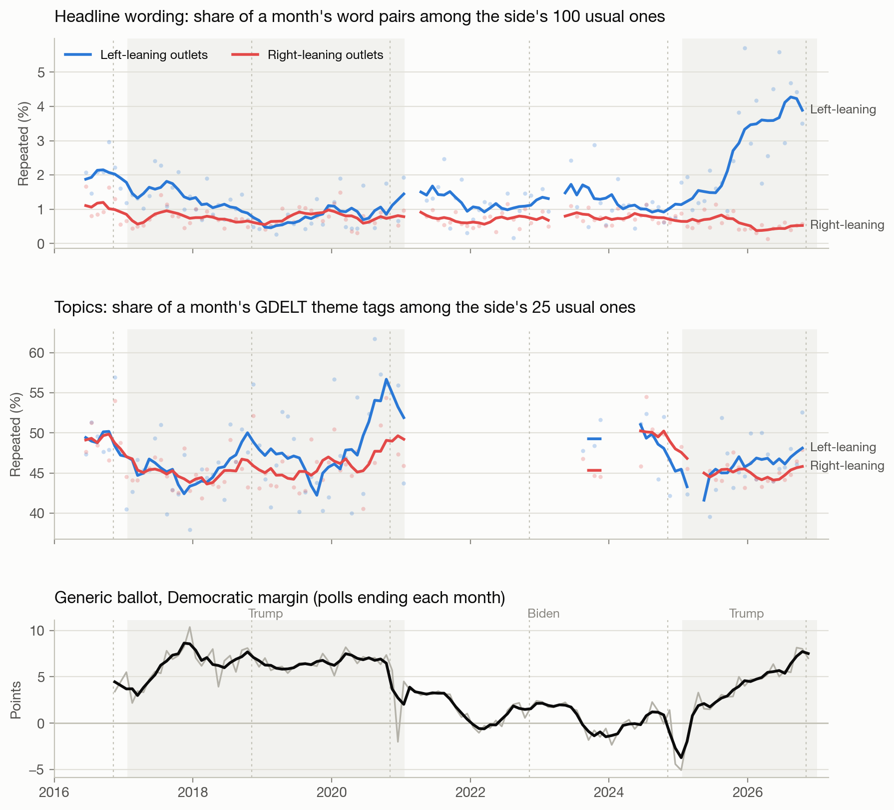
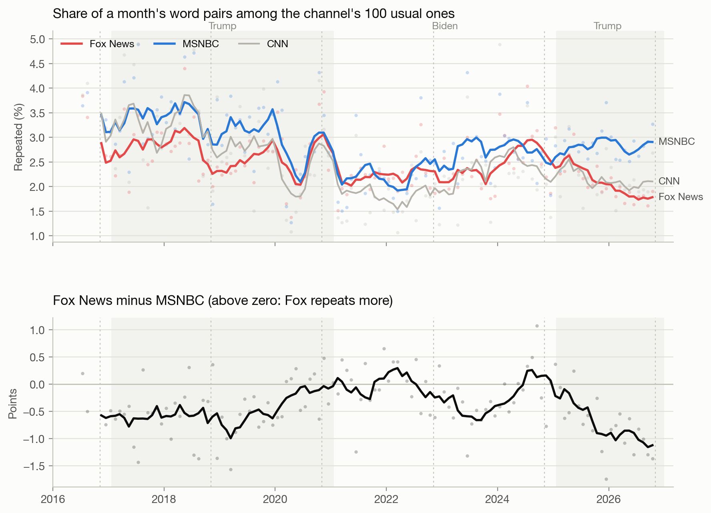

# The talking-points pilot

Written November 9, 2026. Do right-leaning outlets keep repeating the same talking points while left-leaning outlets move on to new ones? And does the gap come before moves in the generic ballot? Code is in [`campaign/talking_points.py`](campaign/talking_points.py) and results are in [`data/talking_points_results.json`](data/talking_points_results.json).

**The short answer.** In this sample it runs the other way. The left-leaning sites repeat more. Their headline wording reuses their usual word pairs about twice as often as the right-leaning sites' does: 1.5% of word pairs against 0.7%. In 2024-2026 the gap is 2.2% against 0.65%, and most of the left's repeats are about Trump. The right-leaning sites didn't get more repetitive after 2024: their repeat share went from 0.80% in 2016-2019 to 0.65% in 2024-2026. On topics (GDELT's theme tags) the two sides are close. Neither measure says anything about the generic ballot over the next three months.

The hunch was about TV talking points, so a TV version followed on November 10, using cable news closed captions (see [Cable news](#cable-news)). It runs the same way, by less. MSNBC reuses its usual word pairs about 1.16 times as often as Fox News (2.85% against 2.46%), and Fox was the more repetitive channel in only 32 of 121 months. Fox didn't get more repetitive after 2024, and 2026 is its least repetitive year. One thing does fit the hunch: Fox kept talking about Joe Biden after he left office. Neither the websites nor TV say anything about the generic ballot. Both measure wording, not claims.

*Top: the share of each side's headline word pairs each month that were among its 100 most common pairs three to five months earlier. Middle: the same for GDELT theme tags, against the side's 25 most common. Both use the corrected run: outlets weighted equally, column titles removed, each headline counted once per side. Dots are months and lines are 6-month centered means. Gaps are months where the left had fewer than 80 articles. Bottom: the generic ballot. Gray bands are Trump's terms and dashed lines are Election Days. Drawn by `campaign/plots/plot_talking_points.py`.*

## Data

**Outlets** ([`data/partisan_outlets.csv`](data/partisan_outlets.csv)). 18 left-leaning and 25 right-leaning political news and opinion sites. Each one has:

- a partisan audience score of at least 0.5 either way, from Robertson et al. (2018), based on which party's Twitter users shared the site;
- an AllSides rating on the same side, from the same file;
- 1,000 or more sharing accounts.

Think tanks, advocacy groups, government sites and aggregators are left out. The left includes MSNBC, Daily Kos, Salon, Raw Story, Mother Jones, Vox and The Nation. The right includes Fox News, Breitbart, the Washington Times, the Washington Examiner, Newsmax, the Daily Caller and The Blaze. CNN, the New York Times and NPR aren't partisan enough by these ratings to qualify, so the left side is smaller opinion sites. The right has full-service news operations.

**Articles** ([`data/talking_points_articles.csv.gz`](data/talking_points_articles.csv.gz)). One full day of GDELT's Global Knowledge Graph every fourth Tuesday, from January 5, 2016 to November 3, 2026, fetched by [`talking_points_fetch.py`](campaign/talking_points_fetch.py). That's 142 days. Three of them (2020-10-06, 2020-11-03, 2021-08-10) are missing some 15-minute files, and the rest of those days is kept. The sample has 207,192 articles: 46,000 left and 161,000 right.

GDELT's crawl of these sites thinned a lot over time. Left articles fell from 9,000 a year in 2016 to about 1,500 in 2021-2022. Right articles fell from 30,000 in 2016 to 6,000 in 2026's first ten months.

**Polls** ([`data/generic_ballot_polls_2017_2026.csv`](data/generic_ballot_polls_2017_2026.csv)). 4,363 generic-ballot polls, built by [`talking_points_ballot.py`](campaign/talking_points_ballot.py). FiveThirtyEight's poll files, archived on March 5, 2025, cover November 2016 to March 2025. Wikipedia's "2026 United States elections polling" page covers the rest. There's one row per poll, using likely voters where a poll asked them, then registered voters, then all adults.

## The rules

These are in `talking_points.py`'s docstring. They were written before any results, but weren't committed separately.

- **Two vocabularies.** (a) GDELT theme tags, without the outside taxonomies (`TAX_`, `WB_`, `CRISISLEX_`, `UNGP_`) and without themes on more than 20% of all articles. (b) Headline word pairs: adjacent words from each URL's slug, without stop words and numbers. Pairs are closer to a talking point, but many are names.
- **Weighting.** Each article counts once, split evenly over its terms. Every side-month is a random draw of 80 articles, averaged over 20 draws. That way the side with fewer articles, and the thinner years, don't look more scattered just from noise.
- **Concentration.** The share of a side's month on its own 10 most common terms.
- **Repeat share** (1 − turnover). The share of a side's month on terms that were among its 100 most common pairs (or 25 themes) over months m-5 to m-3.
- **Gap.** Left minus right, averaged by period with Newey-West standard errors (6 lags).
- **Checks.** Articles shuffled between the sides within each month, where the gap should vanish. Each side's biggest outlet dropped.
- **Timing test.** Does the change in the generic ballot over the next 3 months follow the gap? The model controls for the current margin and the president's party. The reverse is also tested: does the gap follow the last 3 months' change?

**Added after the first run (post hoc).** The first run showed the left more repetitive, and looking at why turned up three problems:

1. Daily Kos supplied 47% of left articles in 2024-2026, so the left side had about 4 effective outlets to the right's 9.
2. Headline pairs were full of column titles, such as "cheers jeers", "kagro morning", "daniel greenfield" and "fox rundown".
3. 5-11% of articles repeat a headline already used on their side: the same story at several URLs, AlterNet and Raw Story (same owner) sharing stories, and recurring posts.

The corrected run makes three changes at once:

- **Equal outlets:** each outlet in a side-month is equally likely to supply an article.
- **Column titles out:** a pair is dropped if one outlet makes 90%+ of its side's uses and it appears on 8+ sampled days. That removes 107 left pairs and 132 right pairs.
- **Each headline once:** each headline slug is kept once per side, the first time it appears.

A fourth check, political articles only, was added for the same reason. The right's list has general-news sites that also cover crime, weather and business, which could make it look broad.

## Results

**Repeat share and concentration, corrected run** (percent; the left-minus-right gap's standard error in parentheses):

| Measure | Period | Left | Right | Left ÷ right | Gap (se) | Months |
|---|---|---|---|---|---|---|
| Headline pairs repeated | 2016-2019 | 1.22 | 0.80 | 1.5 | +0.42 (0.16) | 43 |
| | 2020-2023 | 1.19 | 0.75 | 1.6 | +0.44 (0.08) | 40 |
| | **2024-2026** | **2.20** | **0.65** | **3.4** | +1.55 (0.57) | 34 |
| | All | 1.49 | 0.74 | 2.0 | +0.76 (0.22) | 117 |
| Headline concentration (top 10) | All | 9.17 | 7.14 | 1.3 | +2.03 (0.48) | 128 |
| | 2024-2026 | 11.51 | 7.04 | 1.6 | +4.46 (1.23) | 34 |
| Themes repeated | 2016-2019 | 46.2 | 45.8 | 1.01 | +0.42 (0.59) | 43 |
| | 2020-2023 | 50.8 | 46.8 | 1.09 | +4.03 (0.85) | 15 |
| | 2024-2026 | 46.7 | 46.3 | 1.01 | +0.42 (0.89) | 25 |
| | All | 47.2 | 46.1 | 1.02 | +1.07 (0.56) | 83 |
| Theme concentration (top 10) | All | 34.1 | 30.6 | 1.12 | +3.52 (0.73) | 108 |

**The pre-set run gave the same direction, and larger.** Headline pairs repeated: 2.45% left against 0.82% right overall, and 4.17% against 0.85% in 2024-2026. Themes repeated: 48.1% against 46.5%. The corrections cut the left's headline repetition by about 40% and the right's by about 10%. That's roughly how much of the first result came from Daily Kos and duplicated stories.

**The checks hold.** With articles shuffled between the sides, the repeat-share gaps shrink to 0.25 points or less on headlines and 0.5 or less on themes. With outlets weighted equally, the shuffled concentration gap reaches −0.8 in 2020-2023, so the shuffle isn't a perfect null there. Dropping Daily Kos and Fox News, or using political articles only, leaves the left more repetitive. The political-only run has few months in 2020-2026 because the left runs thin.

**What gets repeated.** These are the pairs that make up most of each side's repeats from June 2025 to October 2026, most first. They come from all articles in those months with outlets weighted equally, rather than the 80-article draws:

- **Left:** "supreme court", "donald trump", "iran war", "right wing", "los angeles", "epstein files", "trump iran", "trump midterms", "trump epstein", "trump tariffs".
- **Right:** "supreme court", "donald trump", "illegal alien", "trump admin", "white house", "gavin newsom", "trump administration", "zohran mamdani".

In 2016-2019 "donald trump" was also the top repeat on both sides. The left's 2025-2026 rise is coverage built around the president.

**The right's own trend.** Its headline repeat share went 0.80%, 0.75%, 0.65% over the three periods. Its theme repeat share went 45.8%, 46.8%, 46.3%, and its concentration is flat. Nothing here says the right started repeating itself more after 2024.

**The president's party.** With a Democratic president, the left's turnover relative to the right's is higher by 0.4 points on headlines (se 0.4) and 1.3 points on themes (se 1.0). So the out-party's sites may repeat more, and the left's 2025-2026 jump fits that, but neither number is clear of noise.

## The timing test

**Nothing, either way.** Over the next 3 months the generic ballot moves 2.1 points on a typical stretch (one standard deviation). In the corrected run, a one-standard-deviation larger repetition gap (left more repetitive) is followed by:

- **headlines:** a ballot move of +0.07 points toward Democrats (se 0.16; 109 months);
- **themes:** a move of −0.10 points (se 0.17; 75 months).

The reverse is also flat. A one-standard-deviation move in the ballot is followed by a change in the headline gap of 0.10 standard deviations (se 0.09). The pre-set run gives the same.

**The six election summers** (headline pairs repeated, June-October average, corrected):

| Year | Left | Right | Left ÷ right | Final generic ballot |
|---|---|---|---|---|
| 2016 | 2.14 | 1.18 | 1.8 | D+0.6 |
| 2018 | 1.02 | 0.61 | 1.7 | D+7.3 |
| 2020 | 1.06 | 0.79 | 1.3 | D+6.8 |
| 2022 | 1.01 | 0.84 | 1.2 | R+2.5 |
| 2024 | 1.01 | 0.79 | 1.3 | R+0.3 |
| 2026 | 4.23 | 0.52 | 8.1 | D+8.4 |

The left was the more repetitive side in all six summers, whichever party did well. With six elections, and the ratio highest when Trump is president or running, this is a description, not a test.

## Cable news

Added November 10, 2026. The hunch came from watching cable news, so this runs the same test on Fox News, MSNBC and CNN closed captions. Code is in [`campaign/talking_points_tv_fetch.py`](campaign/talking_points_tv_fetch.py) and [`campaign/talking_points_tv.py`](campaign/talking_points_tv.py), and results are in [`data/talking_points_tv_results.json`](data/talking_points_tv_results.json).

**The short answer.** MSNBC repeats its usual word pairs more than Fox News does, in most years and in 2026 most of all. Fox's repeat share didn't rise after 2024: 2026 is its lowest year. CNN sat between them in 2016-2019 and at or below Fox since. The gap says nothing about the generic ballot. The one pattern worth following is the president's party. MSNBC is well ahead while Trump is president, and the two are about even under Biden, which fits the out-party's channel repeating more.

*Top: the share of each channel's word-pair uses each month that were among its 100 most used pairs three to five months earlier. Bottom: Fox minus MSNBC; above zero means Fox repeats more. Dots are months and lines are 6-month centered means. Gray bands are Trump's terms and dashed lines are Election Days. Drawn by `campaign/plots/plot_talking_points_tv.py`.*

### Data

- **Captions.** These come from the Internet Archive's TV News Archive, which records the west-coast feeds of Fox News, MSNBC and CNN. Each program's public page shows its closed captions a minute at a time; the caption files themselves are restricted. MSNBC became MS NOW in November 2025, and its archive collection changed with it.
- **Why not GDELT.** GDELT's TV API stops on October 11, 2024, the week of the Internet Archive's cyberattack. That's before the stretch the hunch is about. The Archive's own pages run through 2026.
- **Days.** These are the website pilot's Tuesdays: every fourth Tuesday from January 5, 2016 to October 27, 2026, 142 days. All 426 channel-days are there, about 1,460 minutes of captions each. After reruns and short minutes are dropped, that leaves 566,026 program minutes. One day is thin: MSNBC on June 21, 2016, where only 9 of 23 programs have captions.
- **Storage.** The captions are in `data/raw/tv_captions/` (155 MB), which git ignores. They're the networks' words, so they shouldn't go into the repository.

### The rules

These were written in `talking_points_tv.py`'s docstring while the captions were still downloading, before any results.

- **Reruns** are found by content. A program is dropped if half or more of its 8-word runs already aired earlier that day. The first plan dropped repeated titles, but networks reuse one title ("MSNBC Live", "CNN Newsroom") for different live hours. It was switched before any results.
- **Ads, promos and replayed clips.** Any 8-word run that airs in two or more programs on the same channel-day is masked in all of them. That's 13-28% of words, depending on channel and year.
- **Words.** Stop words, a list of spoken filler ("going", "know", "think", "people") and network names are skipped. So are words seen on fewer than 3 channel-days, which are mostly caption garble.
- **Terms.** Word pairs: adjacent kept words within a minute, not crossing a masked span. Word triples are used as a check.
- **Program catchphrases.** A pair is dropped from a channel if one program makes 90%+ of that channel's uses and uses it on 8+ sampled days. This is the website pilot's column-title rule. It drops 375 Fox pairs, 239 MSNBC pairs and 138 CNN pairs. Most are hosts' names and segment titles ("politics lead", "willie geist", "outside beltway"), plus the copy of a drug ad that ran in the same Fox program week after week.
- **Minutes and weighting.** Minutes with fewer than 10 pair uses are dropped. Every channel-month is a draw of 400 minutes, each program equally likely to supply one, averaged over 20 draws. Each use of a pair counts once.
- **Measures.** Repeat share is the share of a month's pair uses among the channel's 100 most used pairs three to five months earlier. Concentration is the share on the month's own top 10.
- **Hypotheses.** H1: Fox repeats more than MSNBC in 2024-2026. H2: Fox's repeat share rose from 2016-2023 to 2024-2026, more than MSNBC's did. H3: the gap comes before generic-ballot moves, using the website pilot's timing test unchanged. CNN is a reference: if all three move together, the cause is caption format or the news cycle, not partisan style.

### Results

**Repeat share by period** (percent of word-pair uses; the gap's standard error in parentheses):

| Period | MSNBC | Fox | CNN | MSNBC ÷ Fox | Fox − MSNBC (se) | Months |
|---|---|---|---|---|---|---|
| 2016-2019 | 3.35 | 2.76 | 3.16 | 1.21 | −0.59 (0.05) | 39 |
| 2020-2023 | 2.47 | 2.30 | 2.04 | 1.08 | −0.17 (0.09) | 48 |
| **2024-2026** | **2.83** | **2.34** | **2.31** | **1.21** | −0.48 (0.19) | 34 |
| All | 2.85 | 2.46 | 2.48 | 1.16 | −0.39 (0.08) | 121 |

**By year:**

| Year | MSNBC | Fox | CNN | Months Fox was ahead |
|---|---|---|---|---|
| 2016 | 3.64 | 3.29 | 3.72 | 1 of 3 |
| 2017 | 3.41 | 2.81 | 3.20 | 1 of 12 |
| 2018 | 3.33 | 2.78 | 3.33 | 2 of 12 |
| 2019 | 3.24 | 2.56 | 2.82 | 0 of 12 |
| 2020 | 2.79 | 2.63 | 2.37 | 6 of 12 |
| 2021 | 2.21 | 2.18 | 1.86 | 6 of 12 |
| 2022 | 2.20 | 2.20 | 1.75 | 8 of 12 |
| 2023 | 2.70 | 2.20 | 2.19 | 0 of 12 |
| 2024 | 2.79 | 2.76 | 2.53 | 6 of 12 |
| 2025 | 2.89 | 2.36 | 2.31 | 2 of 12 |
| 2026 | 2.79 | 1.83 | 2.04 | 0 of 10 |

**Concentration** points the same way. MSNBC puts 2.36% of its pair uses on its month's top 10, Fox 1.89% (gap 0.48, se 0.04).

**H1 and H2 fail.** In 2024-2026 Fox repeats less than MSNBC, not more. Fox's own repeat share changed by −0.16 points from 2024 on (se 0.20), and the Fox-minus-MSNBC gap by −0.12 (se 0.21). Fox came closest to MSNBC, or passed it, in 2020-2022 and in mid-2024, during the presidential campaign. Since late 2025 it has been the least repetitive of the three channels.

**The checks hold:**

- **Shuffled minutes.** With minutes shuffled between Fox and MSNBC within each month, the gap shrinks to 0.05 points or less.
- **K = 500.** Counting the 500 usual pairs instead of 100 gives MSNBC 4.45% against Fox 3.87% (gap −0.58, se 0.10).
- **Biggest programs dropped.** Without each channel's biggest program (Fox & Friends, Morning Joe, CNN News Central), the gap is −0.35 (se 0.08).
- **Triples.** MSNBC 0.29% against Fox 0.24%. Fox is slightly ahead in 2020-2023 (0.247 against 0.235).
- **Caption garble.** Words dropped as garble are 0.4-2.5% of each channel-year. Fox is a little higher in 2022-2026. Each garbled word spoils at most two pairs, so that's worth a few hundredths of a point, not the gap.
- **Ads.** None of the pairs that make up the repeats are ad copy.
- **Without Trump and Biden (post hoc).** Pairs naming Trump or Biden make up more of MSNBC's repeats than Fox's: 0.93 points against 0.68 in 2025-2026. So they were dropped as a check. MSNBC still repeats more: 2.08% against 1.82% (gap −0.26, se 0.06). In 2024-2026 it's 1.88% against 1.63% (−0.24, se 0.17).

**What gets repeated** in 2025-2026. These are the pairs that make up most of each channel's repeat share, most first:

- **MSNBC:** "donald trump", "white house", "united states", "president trump", "trump administration", "supreme court", "health care", "attorney general", "justice department", "epstein files", "jeffrey epstein", "pam bondi".
- **Fox:** "president trump", "united states", "white house", "donald trump", "trump administration", "law enforcement", "democratic party", "joe biden", "york city", "los angeles", "middle east", "common sense".
- **CNN:** much like MSNBC, plus "prime minister" and "gas prices".

It's mostly names and institutions on all three channels. The repeat share measures how much a channel keeps returning to the same people and places, not the same arguments.

**Biden after Biden.** This is the clearest piece of the hunch in the data. Fox kept naming Joe Biden after he left office. In 2025, 0.51% of its word-pair uses named him, against 0.20% on MSNBC and 0.28% on CNN. In 2026 it was 0.18%, against 0.10% and 0.12%. While he was president, Fox named him more than the others did too: 1.3-1.9% of pair uses in 2021-2024, against 0.6-1.3%. So Fox did return again and again to one target. It faded through 2025, though, and it doesn't make Fox's vocabulary as a whole more recycled.

**Same clips all day? (post hoc).** The 8-word mask also measures how much of a channel's day is the same words replayed across its programs. Fox's masked share rose from 13-14% in 2016-2017 to 25-28% in 2025-2026, while MSNBC's was 15-19%. [`talking_points_tv_replays.py`](campaign/talking_points_tv_replays.py) splits the masked words by keyword:

- **Political replays** are small and close across channels: 1-3% of words. In 2025 Fox had 1.9% and MSNBC 1.2%; in 2026, 1.4% and 1.0%.
- **Fox's rise** is mostly the rest: promos, teases, show openings and ads without the usual ad words.

Fox's most replayed political clips in 2025-2026 include Biden material (his family pardons, Jill Biden), an exchange on whether Trump had issued "illegal orders", and Trump's pledge to declare a border emergency. The keyword lists were set after seeing the results, so this is a reading, not a test.

### Timing and the president's party

**Nothing on the ballot.** A one-standard-deviation larger gap (MSNBC more repetitive) is followed by a ballot move of −0.20 points (se 0.22; 116 months). A typical three-month move is 2.1 points. The reverse is flat: −0.01 standard deviations (se 0.07).

**The president's party.** The Fox-minus-MSNBC gap is 0.42 points higher when a Democrat is president (se 0.12). Fox minus MSNBC averages −0.48 points in Trump's first term and −0.78 in his second, against −0.14 under Biden (Fox was ahead in 8 of 12 months in 2022). Without Trump and Biden pairs it's 0.33 (se 0.10). The websites pointed the same way, at 0.4 (se 0.4). Two sources agreeing is worth noting, but there are only four presidential terms here. Lineup changes line up with them too: Rachel Maddow went weekly in 2022, and Fox dropped Tucker Carlson in 2023. So this is a lead, not a finding.

**The six election summers** (repeat share, June-October average):

| Year | MSNBC | Fox | CNN | MSNBC ÷ Fox | Final generic ballot |
|---|---|---|---|---|---|
| 2016 | 3.78 | 3.63 | 3.98 | 1.04 | D+0.6 |
| 2018 | 3.23 | 2.64 | 3.22 | 1.22 | D+7.3 |
| 2020 | 2.94 | 2.69 | 2.66 | 1.09 | D+6.8 |
| 2022 | 2.60 | 2.43 | 2.01 | 1.07 | R+2.5 |
| 2024 | 2.72 | 3.03 | 2.49 | 0.90 | R+0.3 |
| 2026 | 2.91 | 1.75 | 2.11 | 1.66 | D+8.4 |

Fox was the more repetitive channel in one summer, 2024. That was Trump's comeback, which Republicans narrowly won. In 2026 MSNBC was furthest ahead, and Democrats lead the ballot by the most. With six elections, that's a description, not a test.

## Status

| Question | Answer | Status |
|---|---|---|
| Right-leaning sites repeat more than left-leaning ones | The other way: left 2.0x on headline wording, about even on topics | Rejected |
| Right-leaning sites repeat more since 2024 | Their repeat share fell slightly; the left's rose | Rejected |
| The repetition gap comes before generic-ballot moves | No, and no reverse either | Rejected |
| Out-party sites repeat more | Fits the left's 2025-2026 jump, not clear of noise | Can't tell |
| Fox News repeats more than MSNBC | The other way: MSNBC 1.16x, Fox ahead in 32 of 121 months | Rejected |
| Fox News repeats more since 2024 | Its repeat share fell; 2026 is its lowest year | Rejected |
| The TV gap comes before generic-ballot moves | No, and no reverse either | Rejected |
| The out-party's channel repeats more | Gap 0.42 points toward Fox under Democratic presidents (se 0.12), same direction on websites; only four terms | Lead |

## Limits

- **TV is three channels.** The TV test covers Fox News, MSNBC and CNN, not Newsmax, OAN or talk radio. Fox is the right's main channel, but the hunch could fit a smaller one.
- **Clips and ads are masked.** Words replayed verbatim across a channel's programs that day are masked, so a sound bite played on every show counts once per program at most. The replay check suggests that doesn't hide much political material, but its keyword split is rough.
- **Words and topics, not claims.** On both websites and TV, the repeated pairs are mostly names and places. Headline pairs are mostly names and places ("donald trump", "supreme court"). A side could make the same claim under varied headlines, or vary its claims under the same name. Pulling out claims needs article or caption text and a language model. The captions are already downloaded.
- **Unequal sides.** The left list is smaller opinion sites; the right has general-news operations. Equal-outlet weighting and the political-only run address this, but the left still has fewer active outlets (12-15 a year against 13-20).
- **Thin and shrinking data.** GDELT's crawl of the left sites fell sharply after 2020, and many 2021-2023 months drop out of the themes panel. Only every fourth Tuesday is sampled. `talking_points_fetch.py` can fill in the other weeks (passes 2-4, about 45 minutes each), and `talking_points_tv_fetch.py` the same for TV (about 2.5 hours a pass).
- **Post-hoc corrections.** Four corrections were added after seeing the first run. They shrank the result but didn't flip it, and the pre-set run is reported alongside.
- **Labels from 2017-2018.** The audience scores and AllSides ratings are from 2017-2018. Outlets founded later, such as MeidasTouch and the Bulwark, aren't in the list.

## Prior art

Benkler, Faris and Roberts (*Network Propaganda*, 2018) found the right-wing media ecosystem more inward-looking than the left's, using Media Cloud link and sharing networks. That's about who cites whom, not repetition, so it doesn't conflict with this. On cable news, Martin and Yurukoglu (*American Economic Review*, 2017) measured Fox and MSNBC slant from phrase use and estimated its effect on votes. Kim, Lelkes and McCrain (*PNAS*, 2022) tracked slant over time from cable news transcripts. Both measure which side's words a channel uses, not how often it repeats itself. Petrocik's issue-ownership theory (1996) expects each side to keep returning to the issues it's trusted on, which predicts repetition on both sides.

Robertson, R. E., Jiang, S., Joseph, K., Friedland, L., Lazer, D., & Wilson, C. (2018). Auditing partisan audience bias within Google Search. *Proceedings of the ACM on Human-Computer Interaction*, 2(CSCW), 148.
